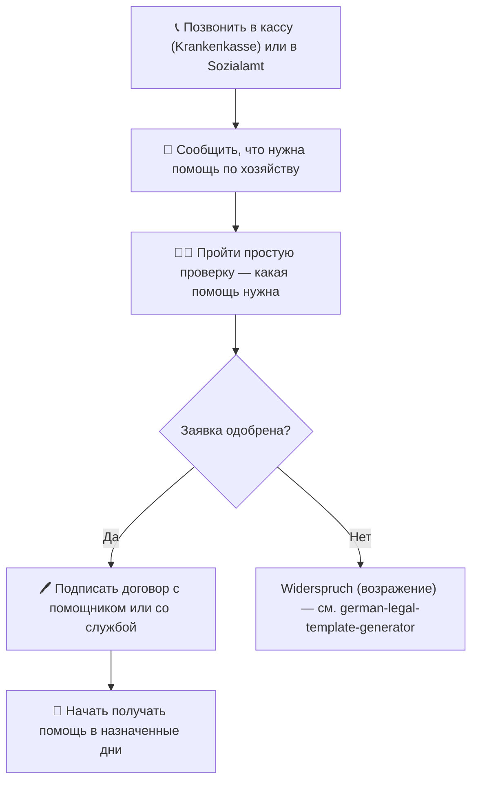

# Помощь по хозяйству — алгоритм

> Сгенерировано из того же `haushalt-assistenz.source.json` (представление 2 из 4). Шаги и точки принятия решений взяты из полей `steps` и `decision_points` — те же данные, что и в подробном тексте.

