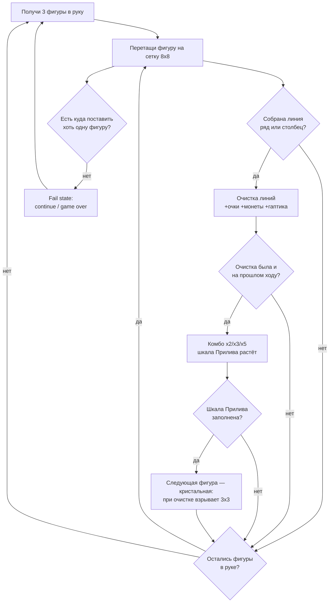

# 03 — Ядро геймплея

Навигация: [← Рынок](02-market.md) | [README](README.md) | [Мета-прогрессия →](04-meta-progression.md)

---

## 1. Core loop



Петля второго порядка (сессия): партия → монеты/очки → миссии и стрик → следующая партия или Фигурное поле → см. [главу 04](04-meta-progression.md).

## 2. Полные правила

### 2.1 Базовые правила (общие для всех режимов)

1. Поле — сетка **8×8** (Фигурные поля — маски на сетке 9×9, см. §2.4).
2. Игрок получает **3 фигуры** («рука»). Фигуры можно ставить в любом порядке, вращения **нет** (стандарт жанра: вращение повышает порог входа).
3. Фигура ставится на свободные клетки целиком; частичное наложение запрещено.
4. Полностью заполненный ряд (8 клеток) или столбец очищается. Одновременная очистка нескольких линий даёт мультибонус (§2.2).
5. Когда все 3 фигуры размещены — выдаётся новая тройка.
6. **Fail state:** ни одну из оставшихся фигур некуда поставить → предложение спасения (§6), затем game over / провал уровня.
7. Таймера нет ни в одном режиме. Ход можно обдумывать бесконечно.

### 2.2 Очки

| Событие | Очки |
|---------|------|
| Размещение фигуры | 1 очко за клетку фигуры |
| Очистка 1 линии | 10 |
| 2 линии одним ходом | 30 (10+20) |
| 3 линии одним ходом | 60 |
| 4+ линий одним ходом | 100 |
| Множитель комбо (§2.3) | ×2 / ×3 / ×5 на очки очисток |
| Взрыв кристальной фигуры | 40 + очки очищенных клеток |
| «Чистое поле» (все клетки пусты после хода) | 300 |

### 2.3 Дифференциатор 1 — «Прилив» (Surge)

- **Комбо-цепь:** если очистка линий происходит на последовательных *ходах* (не обязательно каждой фигурой руки), растёт счётчик комбо: 2 хода подряд → ×2, 3 → ×3, 4+ → ×5 (потолок). Ход без очистки сбрасывает комбо (с «прощением»: первый ход новой тройки не рвёт цепь — окно планирования).
- **Шкала Прилива:** каждая очистка добавляет заряд = 10 × текущий множитель (шкала 100). Визуально — волна света, поднимающаяся по краю поля.
- **Кристальная фигура:** при заполнении шкалы следующая выданная фигура становится кристальной. Если она участвует в очистке линии — взрывается область 3×3 вокруг её центра, шкала сбрасывается. Если игрок «сжёг» кристалл без очистки — эффект пропадает (решение имеет цену).
- Дизайн-цель: Прилив создаёт **среднесрочное планирование** (2–4 хода вперёд) и кульминацию партии, не усложняя базовые правила: новичок может полностью игнорировать шкалу и играть как в Block Blast!.

### 2.4 Режимы

| Режим | Суть | Fail | Роль в продукте |
|-------|------|------|-----------------|
| **Путешествие** (основной) | Уровни с целями: «набери N очков», «очисти X линий», «разбей все камни» (клетки-препятствия), лимит — количество фигур (не время) | Кончились фигуры до цели | Прогрессия, туториал сложности, точка interstitial ([06](06-monetization.md)) |
| **Классика** (endless) | Бесконечная партия на рекорд | Некуда ставить | Длинные сессии, лидерборд, ядро для персоны «Кэндзи» |
| **Фигурные поля** (daily) | Дифференциатор 2: сетка нестандартной формы (маска на 9×9), тематическая по сезону; 1 бесплатный запуск/день | Некуда ставить | Ежедневный возврат, rewarded-плейсмент RW-4, UA-креативы |

## 3. Управление и ввод

| Аспект | Решение |
|--------|---------|
| Основной жест | Drag & drop: палец на фигуре в «руке» → фигура увеличивается до размера клеток поля и поднимается на **80 px выше пальца** (видимость под пальцем — критично для 45+) |
| Ghost-preview | Полупрозрачный силуэт на ближайшей валидной позиции; подсветка линий, которые будут собраны этим ходом (зелёное свечение) |
| Прилипание | Snap к клетке при попадании ≥60% площади фигуры |
| Отмена жеста | Отпустить фигуру вне поля → возврат в руку без штрафа |
| Гаптика | Лёгкая — постановка; средняя — очистка; нарастающая серия — комбо; сильная — кристальный взрыв |
| Альтернативный ввод | Tap-tap (выбор фигуры → тап по клетке) — в настройках, для пользователей с тремором |
| Ориентация | Портрет фиксированно; поле занимает ~55% высоты экрана |

## 4. Генерация контента

### 4.1 Генератор фигур (общий для всех режимов)

Пул из **14 форм**: моно (1), домино (2), трио I/L (2), тетрамино I/O/L/S/T (5), пентамино P/L/крест/I5 (4). Каждая форма имеет вес и «индекс неудобства» H (1–5).

Алгоритм выдачи тройки:

```
1. Сформировать взвешенный мешок по текущему уровню сложности D (§5)
2. Вытянуть 3 фигуры без возврата (не более 1 фигуры с H=5 в тройке)
3. SOLVENCY-CHECK: жадный солвер ищет хотя бы ОДНУ последовательность
   размещения всех трёх фигур на текущем поле
4. Если решения нет → reroll (до 3 попыток)
5. Если после 3 reroll решения нет → форс-замена самой неудобной фигуры
   на «спасательную» (моно или домино)
6. АНТИФРУСТРАЦИЯ: если заполнено >70% поля — вес малых фигур ×1.5
```

Гарантия честности: game over наступает только из-за решений игрока на предыдущих ходах, а не из-за «невозможной» тройки. Это осознанное отличие от жёстких клонов: наша аудитория платит ретеншеном за ощущение справедливости.

### 4.2 Генератор уровней «Путешествия»

- Уровень = seed + стартовый паттерн (предзаполненные клетки/камни) + цель + бюджет фигур.
- Паттерны собираются из библиотеки шаблонов (~40 шаблонов на сезон), параметризованных плотностью заполнения p и числом камней k.
- Бюджет фигур: `budget = ceil(cells_to_clear / avg_cells_per_piece × (1 + slack))`, где slack — запас прочности: 0.45 на уровнях 1–20, 0.30 на 21–60, 0.20 дальше.
- Валидация: автоплей-бот (жадный + 2-ply поиск) прогоняет уровень 200 раз; целевой winrate бота задаёт фактическую сложность (§5.2). Уровни вне коридора — автоперегенерация с новым seed.

### 4.3 Генератор Фигурных полей

- Маска формы (сердце, звезда, лист, тыква...) хранится как битовая карта 9×9; библиотека пополняется контент-конвейером без релиза приложения (remote config, см. [10](10-production.md)).
- Правило валидности маски: связная область ≥45 клеток, каждая строка/столбец маски, участвующие в очистке, содержат ≥4 клетки (иначе линии слишком дешёвые).
- Очистка на фигурных полях — по полным строкам/столбцам *в пределах маски*.

## 5. Кривая сложности

### 5.1 Формулы

Сложность уровня n задаётся управляющим параметром D(n) ∈ [0,1]:

```
D(n) = min(0.85, 0.18 + 0.10·log10(n+1) + spike(n))
spike(n) = +0.12, если n mod 10 == 0     (пиковый уровень)
           −0.06, если n mod 10 == 1     (уровень-передышка после пика)
           0 иначе
```

D(n) транслируется в параметры генераторов:

| Параметр | Формула | Смысл |
|----------|---------|-------|
| Вес неудобных фигур (H≥4) | `w_hard = 0.10 + 0.45·D` | Больше пентамино на поздних уровнях |
| Плотность стартового паттерна | `p = 0.05 + 0.30·D` | Заполненность поля на старте |
| Камни | `k = round(6·D)` | Препятствия, требующие двойной очистки |
| Slack бюджета фигур | `slack = 0.45 − 0.30·D` | Запас ходов сверх минимума |

### 5.2 Целевые fail-rate (валидируются ботом и телеметрией)

| Сегмент уровней | Целевой fail rate игрока | Роль |
|-----------------|--------------------------|------|
| 1–5 | 0–2% | FTUE, поражение практически невозможно |
| 6–20 | 5–10% | Обучение цене ошибки; первые continue |
| 21–60 | 12–18% | Рабочий режим; спрос на бустеры ([05](05-economy.md)) |
| 61+ | 18–25%, пики до 30% на n mod 10 | Дефицит → монетизация; после пика всегда передышка |

«Классика»: сложность растёт внутри партии — после каждых 500 очков w_hard +0.03 (потолок 0.55). Телеметрический контроль: медианная длина партии 6–9 минут ([09](09-analytics-kpi.md), событие `game_end`).

## 6. Fail states и механики спасения

| Ситуация | Предложение | Цена | Ограничения |
|----------|-------------|------|-------------|
| Некуда ставить (Классика) | **Второй шанс**: очистить 2 случайных ряда + 2 столбца и продолжить с сохранением очков и комбо | Rewarded (RW-1) или 200 монет | 1-й раз за партию — rewarded/монеты; 2-й — только 400 монет; 3-го нет |
| Провал уровня (Путешествие) | **+3 фигуры к бюджету** | Rewarded (RW-1) или 200 монет | 1 раз за попытку уровня |
| Провал уровня, отказ от спасения | Бесплатный повтор уровня немедленно | — | Interstitial по правилам [06](06-monetization.md) §3 |
| Ошибка хода | **Отмена** (undo последнего хода) | Бустер Undo (80 монет) | Нельзя после очистки линии кристальной фигурой |
| Тупик по решению игрока | Бустеры: **Молот** (разбить 1 клетку, 150) и **Обмен** (заменить тройку фигур, 120) | Монеты / инвентарь | Без лимита, но цены растут в рамках баланса [05](05-economy.md) |

Принцип: любое поражение конвертируется либо в rewarded-показ, либо в трату монет, либо в мгновенный ре-энтри — но никогда в «стену» (нет энергии/жизней, вход в игру всегда бесплатен).

## 7. Сессия игрока по минутам (референсная сессия D7, персона «Марта»)

| Минута | Активность | Системы |
|--------|-----------|---------|
| 0:00–0:20 | Запуск, daily-бонус (колесо), взгляд на стрик 5/7 | LiveOps [08](08-liveops.md) |
| 0:20–1:00 | Экран миссий: «очисти 15 линий» 11/15 → кнопка «Играть» | Мета [04](04-meta-progression.md) |
| 1:00–4:30 | Уровень 34 «Путешествия»: к 3-й минуте комбо ×3, шкала Прилива 80% | Ядро |
| 4:30–5:00 | Победа; экран награды: +40 монет, предложение ×2 за rewarded → смотрит (RW-2) | Монетизация [06](06-monetization.md) |
| 5:00–5:30 | Interstitial (INT-1, capping соблюдён) → карта уровней | Монетизация |
| 5:30–9:00 | Уровень 35: провал за 2 клетки до цели → rewarded «+3 фигуры» (RW-1) → победа | Ядро + монетизация |
| 9:00–9:30 | Миссия закрыта (+60 монет); бейдж «Фигурное поле дня не пройдено» | Мета |
| 9:30–13:00 | Фигурное поле «Звезда»: новая форма, рекорд дня | Дифференциатор 2 |
| 13:00–13:30 | Interstitial (INT-2) → главный экран; push-настройка стрика уже включена | Монетизация |
| 13:30–14:00 | Заглядывает в магазин (копилка 68% полна), выходит | Экономика [05](05-economy.md) |

Итог сессии: ~14 минут, 2 interstitial, 2 rewarded, +140 монет, стрик поддержан. Целевые сессионные метрики: 3.0 сессии/DAU, средняя сессия ~7 мин, ~21 мин/день ([09](09-analytics-kpi.md) §4).

---

Следующая глава: [04 — Мета-прогрессия](04-meta-progression.md)
