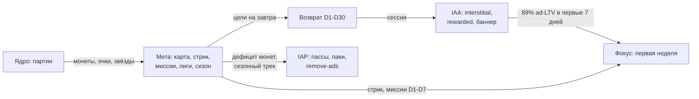

# 04 — Мета-игра и прогрессия

Навигация: [← Ядро геймплея](03-core-gameplay.md) | [README](README.md) | [Экономика →](05-economy.md)

Принцип главы: мета у нас **легковесная** — она обслуживает возврат и монетизацию, но не требует от игрока изучать «вторую игру» (урок Solitaire Grand Harvest: мета удваивает IAP, урок Block Blast!: перегруз меты не нужен ядру). Каждый слой ниже обязан отвечать на вопрос «зачем вернуться завтра?».

---

## 1. Слои прогрессии (обзор)

| Слой | Горизонт | Что двигает | Связь с монетизацией |
|------|----------|-------------|----------------------|
| Карта «Путешествия» | недели–месяцы | Прохождение уровней, главы по 20 уровней | Interstitial-точки, спрос на бустеры на пиковых уровнях |
| Рекорд «Классики» + лиги | неделя | Очки, недельный турнир | Длинные сессии → баннер + interstitial объём |
| Стрик дней | день | Вход и 1 победа в день | Восстановление стрика: rewarded/монеты |
| Миссии (daily/weekly) | день/неделя | Целевые действия | Earn-источник монет, направляет в режимы |
| Сезон (4 недели) | месяц | Сезонные очки со всех активностей | Season Pass $4.99 ([06](06-monetization.md) §5) |
| Коллекция скинов | месяцы | Сезонные награды, магазин | Sink монет + IAP-эксклюзивы |

## 2. Карта «Путешествия»

- Структура: главы по 20 уровней, каждая глава — визуальная тема (смена палитры фона, бесплатный контент-ритм). Уровни см. [03](03-core-gameplay.md) §4.2, §5.
- Звёзды: 1–3 звезды за уровень (по перевыполнению цели). Звёзды открывают сундуки главы (на 15/35/55 звёзд в главе): монеты, бустеры, фрагменты скина.
- Врата главы: переход в новую главу требует N звёзд (мягкий гейт: N достижим при среднем прохождении на 1.6★; перепрохождение уровней на звёзды — легальный «гринд» без энергии).
- Пиковые уровни (каждый 10-й) — «босс-уровни» с усиленной наградой ×2 монет: пик сложности совпадает с пиком награды, там же пик спроса на бустеры.

## 3. Стрик дней («Серия»)

- Условие дня: 1 победа в любом режиме (низкий порог — защита ретеншена, не источник фрустрации).
- Цикл 7 дней, награды нарастают:

| День серии | 1 | 2 | 3 | 4 | 5 | 6 | 7 |
|-----------|---|---|---|---|---|---|---|
| Награда (монеты) | 30 | 40 | 50 | 60 | 80 | 100 | 150 + бустер Молот |

- После дня 7 цикл повторяется с бейджем уровня серии (7/30/100/365 дней — метазначки в профиле).
- **Восстановление:** пропуск одного дня → стрик замораживается на 24 часа, восстановление за rewarded (RW-4-вариант) или 100 монет. Пропуск 2+ дней → сброс. Данные жанра: угроза потери стрика — сильнейший push-триггер ([08](08-liveops.md) §5).

## 4. Миссии

### 4.1 Ежедневные (3 шт., ротация из пула)

| Тип миссии | Пример | Награда |
|------------|--------|---------|
| Объём ядра | «Очисти 15 линий» | 40 монет |
| Навык | «Собери комбо ×3» | 60 монет |
| Направляющая | «Сыграй Фигурное поле» / «Пройди 2 уровня» | 40–60 монет |

Все 3 закрыты → бонус-сундук 60 монет. Итого потолок дня ~220 монет из миссий (сверено с earn-rate в [05](05-economy.md) §4).

### 4.2 Недельные (10 шт.)

Крупные цели («заработай 2000 очков в Классике», «активируй 5 кристальных фигур») → сезонные очки + 300–500 монет суммарно. Недельные миссии — основной насос сезонных очков (§6).

## 5. Лиги и социальный слой

- **Недельный турнир Классики:** асинхронная лига на 50 игроков схожего уровня (по лучшему счёту недели). Лиги: Бронза → Серебро → Золото → Платина → Алмаз. Топ-10 повышаются, низ-10 понижаются. Награды недели: 100–500 монет + сезонные очки.
- Социальный слой сознательно минимален: **никакого чата, кланов, PvP** (профиль аудитории — см. [01](01-concept.md) §4.2). Только: лидерборд лиги, сравнение рекорда с «игроками вашей страны», шаринг результата Фигурного поля (изображение поля — вирусный крючок, deep link).
- Античит лиги: серверная валидация очков по телеметрии ходов (`piece_placed` / `line_clear` последовательность, см. [09](09-analytics-kpi.md) §2).

## 6. Сезон (4 недели)

- Сезонная тема задаёт: скин поля/блоков, набор масок Фигурных полей, оформление карты (см. контент-пайплайн, [10](10-production.md) §2, WBS-2).
- **Сезонные очки** капают из: побед (5), звёзд (10), миссий (20–50), турниров (50–200), Фигурных полей (25).
- Трек наград: 30 ступеней. Бесплатная ветка: монеты, бустеры, 1 скин. Платная ветка (Season Pass $4.99): ×3 номинал наград + 2 эксклюзивных скина + 1 билет Фигурного поля/день на остаток сезона + бейдж.
- Ступени рассчитаны так, что активный игрок (5+ дней/нед) закрывает трек к 26-му дню; казуальный — ступень 18–22 (стимул докупить пасс в конце сезона — «catch-up» оффер).

## 7. Коллекция скинов

- Скины: блоки, поле, эффект волны Прилива, звук. Чистая косметика — **никогда** не влияет на геймплей.
- Источники: сезонный трек, сундуки глав (фрагменты 10/10), магазин за монеты (1000–5000), IAP-эксклюзивы в паках ([06](06-monetization.md) §5).
- Роль в экономике: главный долгосрочный sink монет, защита от инфляции ([05](05-economy.md) §6).

## 8. Как мета связана с core loop и монетизацией

Ключевые связки:

1. **Ретеншен = ad-выручка.** 89% рекламной выручки игрока набирается за первые 7 дней → стрик, миссии и первые главы сконструированы под ежедневный возврат первой недели, а не под месячную мету.
2. **Мета создаёт спрос, ядро продаёт.** Пиковые уровни (сложность) + миссии (объём игры) создают ситуации спроса на бустеры/continue; сама продажа происходит в ядре ([05](05-economy.md) §7).
3. **Сезон — контейнер IAP.** Season Pass монетизирует самых удержанных (и смотрящих rewarded: конверсия таких игроков в IAP до 4,5x выше — пасс предлагается после 5+ добровольных rewarded, см. сегментацию в [06](06-monetization.md) §7).
4. **Лиги кормят «Классику».** Турнир двигает длинные сессии режима Классика → максимальный инвентарь баннера и interstitial у толерантной аудитории (персона «Кэндзи»).

## 9. Скоуп-границы меты v1.0

В v1.0 НЕ входят (осознанно, план — бэклог года 1): коллекционные альбомы, мини-игры, декоративная мета «построй сад», кланы, PvP-дуэли. Критерий добавления любого слоя: +X% D30 при ≤2 неделях разработки, проверено A/B ([09](09-analytics-kpi.md) §6).

---

Следующая глава: [05 — Игровая экономика](05-economy.md)
