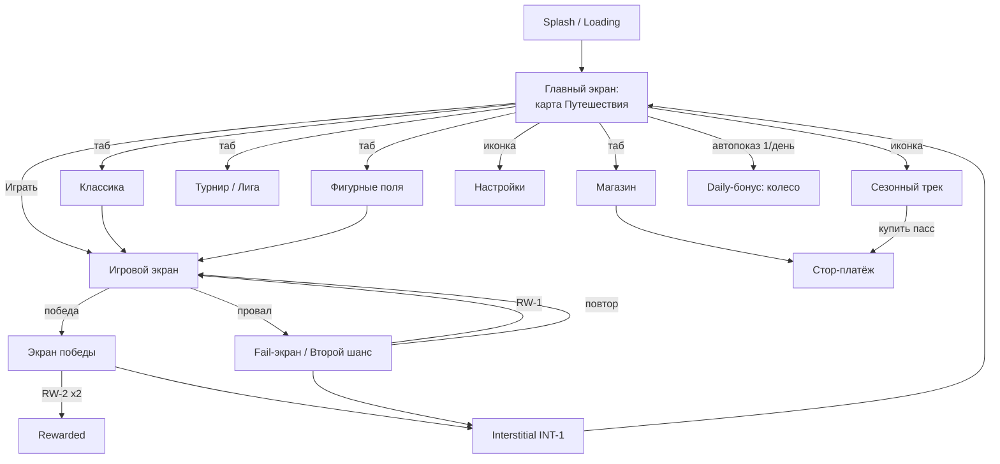

# 07 — UX/UI и FTUE

Навигация: [← Монетизация](06-monetization.md) | [README](README.md) | [LiveOps →](08-liveops.md)

UX-приоритет проекта: аудитория 25–55 со значимой долей 45+ ([01](01-concept.md) §4) → крупные элементы, высокий контраст, минимум текста, ноль скрытых жестов.

---

## 1. Карта экранов и переходов



Правило навигации: из любого экрана до геймплея ≤2 тапа; из геймплея в меню — 1 тап (пауза → выход, с подтверждением при активной партии).

## 2. Wireframe-описания ключевых экранов

### 2.1 Главный экран (карта Путешествия)

```
┌──────────────────────────────┐
│ [профиль] [монеты 1160] [⚙] │  ← верхняя панель, высота 8%
│      СЕЗОН: волна 12/30  ▸   │  ← сезонная полоска-тизер
│                              │
│      ~ карта главы ~         │  ← вертикальная тропа уровней,
│     (34)─(35)─(36)…          │     текущий уровень пульсирует
│    стрик 🔥5   миссии (2/3)  │  ← виджеты возврата
│                              │
│        [ ИГРАТЬ ▶ ур.35 ]    │  ← главная CTA, ширина 70%
│                              │
│ [Путеш.][Классика][Поля][Лига][Магазин] │ ← таб-бар 10% высоты
└──────────────────────────────┘
```

### 2.2 Игровой экран

```
┌──────────────────────────────┐
│ очки 4 320   цель 12/15 ▍▍▍  │  ← прогресс цели уровня
│ комбо ×3   ██████░░ Прилив   │  ← шкала Прилива по верхней кромке
│   ┌────────────────┐         │
│   │   СЕТКА 8×8    │         │  ← ~55% высоты, клетка ≥44 px
│   │                │         │
│   └────────────────┘         │
│    [фиг1] [фиг2] [фиг3]      │  ← «рука», зона 20% высоты
│  [Молот 2] [Обмен 1] [Undo]  │  ← бустеры с бейджами количества
│ ─────────── banner ───────── │  ← BAN-1, adaptive, вне зоны жестов
└──────────────────────────────┘
```

Ключевые UX-решения: фигура при драге поднята на 80 px над пальцем; подсветка будущих очисток зелёным; кнопки бустеров крупные (56 px), но вне траектории драга; баннер отделён от «руки» отступом ≥16 px (защита от мисс-кликов = требование политик сетей).

### 2.3 Экран победы

Порядок блоков: (1) звёзды с анимацией, (2) награда монет, (3) **кнопка «×2 за видео» (RW-2) — крупная, но ниже основной** «Забрать», (4) прогресс миссий тикает тут же. Отказ от ×2 не наказывается interstitial'ом мгновенно ([06](06-monetization.md) §3, правило 5).

### 2.4 Fail-экран («Второй шанс»)

Центр: оффер спасения (RW-1 / 200 монет) с 5-сек ненавязчивым пульсом; ниже — «Повторить» и «В меню». Никакого таймера обратного отсчёта на офер: аудитория 45+ не должна принимать решения под давлением — осознанное отличие от жанрового стандарта.

### 2.5 Магазин

Вертикальные секции: Remove Ads (закреплён сверху до покупки) → Копилка → Паки монет → Скины. Витрина ≤6 SKU одновременно ([06](06-monetization.md) §5). Каждый пак показывает бонус-% против базового курса.

## 3. Первые 5 минут — FTUE по шагам

| # | Время | Шаг | Обучение | Монетизация |
|---|-------|-----|----------|-------------|
| 1 | 0:00 | Холодный старт → сразу игровое поле уровня 1 (без регистраций, выборов, разрешений) | — | — |
| 2 | 0:05 | Рука с 1 фигурой, палец-подсказка: перетащи | Драг-жест | — |
| 3 | 0:20 | Вторая фигура достраивает почти полный ряд → первая очистка, конфетти+гаптика | Правило линии | — |
| 4 | 0:45 | Уровень 1 пройден (30 сек, гарантированно). Награда 25 монет | Цикл «уровень→награда» | — |
| 5 | 1:00–2:30 | Уровень 2: цель «собери 3 линии», подсказка про ghost-preview | Цели уровней | — |
| 6 | 2:30 | Первая очистка 2 линий подряд → тултип «Комбо! Очистки подряд заряжают Прилив» (единственный текстовый тултип FTUE) | Прилив, пассивно | — |
| 7 | 3:00–4:30 | Уровень 3: шкала Прилива доводится до полной скриптово → первая кристальная фигура, взрыв 3×3 | Кульминация фичи | — |
| 8 | 4:30 | Подарок 200 монет + открытие карты Путешествия | Валюта | — |
| 9 | ~5:00 | Уровень 4 — свободная игра без скриптов | — | — |

### Продолжение первой сессии (минуты 5–15)

| Время/уровень | Событие | Монетизация |
|---------------|---------|-------------|
| Уровень 5 | Вводится Молот: подарок 1 шт. + обучающий камень на поле | Первый **rewarded-оффер** (RW-3: «ещё один Молот за видео») — добровольный, после подарка |
| Уровень 6 (≈8–10 мин) | Первый **interstitial** (INT-1) — не раньше 8-й минуты И уровня 6 ([06](06-monetization.md) §3) | Начало INT-ритма, день 1 cap = 5 |
| Уровень 8 | Подарок Обмен + показ fail-механики на подстроенном «почти-тупике» | RW-1 знакомство |
| Конец сессии 1 | Пуш-опросник разрешений: запрашиваем push только после первой победы, с показом выгоды («напомним о стрике и бонусе») | — |
| День 2, вход | Daily-бонус + билет Фигурного поля в подарок → знакомство с режимом | RW-4 знакомство |

KPI FTUE (события `ftue_step`, [09](09-analytics-kpi.md) §2–3): завершение шага 4 ≥85% установок, шага 9 ≥70%, конверсия в D1 ≥38% (база).

## 4. Доступность

| Аспект | Требование |
|--------|-----------|
| Шрифты | Мин. 16 sp основной текст, 14 sp — второстепенный; системный масштаб шрифта поддерживается до 130% без ломки лейаута |
| Дальтонизм | Блоки различаются не только цветом: каждый цвет имеет уникальную текстуру/иконку на клетке (режим «Узоры» в настройках; протанопия/дейтеранопия — палитры проверяются симулятором) |
| Контраст | ≥4.5:1 текст/фон; неоновая тема тестируется на дешёвых LCD (не только OLED) |
| Моторика | Хит-зоны ≥48 dp; альтернативный ввод tap-tap ([03](03-core-gameplay.md) §3); undo прощает мисклики |
| Старшая аудитория | Режим «Крупные фигуры» (+15% масштаб руки); отсутствие таймеров — системное решение; тексты коротки, иконки подписаны |
| Аудио | Полная играбельность без звука; гаптика дублирует ключевые события; отдельные ползунки музыка/эффекты |
| Локализация | v1.0: EN, JA, DE, FR, ES, PT-BR, KO, RU. Тексты в JSON-ключах с первого дня ([10](10-production.md) §3); японская типографика проверяется носителем (Tier-1 рынок) |
| Reduced motion | Опция отключения тряски/параллакса; эпилепсия-safe: волна Прилива без стробоскопа, вспышки ≤3 Гц |

## 5. UX-правила для рекламы (сводка с [06](06-monetization.md))

1. Кнопка rewarded всегда показывает награду и длительность («×2 · видео 30 сек»).
2. Закрытие interstitial — системный крестик сети, мы не перекрываем его своим UI.
3. После interstitial игрок возвращается ровно на тот экран, откуда ушёл, состояние сохранено.
4. Отсутствие «фейковых крестиков», псевдо-кнопок и dark patterns — категорический запрет ([02](02-market.md), риск R4).
5. Баннер никогда не перекрывает игровые элементы; на устройствах с вырезом — safe area учитывается.

---

Следующая глава: [08 — LiveOps и удержание](08-liveops.md)
