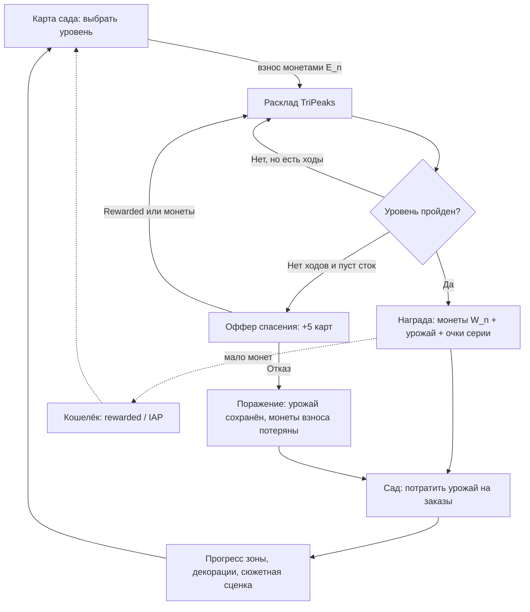

# 03. Ядро геймплея

**Проект:** Orchard Peaks. Назад: [02-market.md](02-market.md) · Далее: [04-meta-progression.md](04-meta-progression.md)

---

## 3.1. Core loop



Петля короткая (2–4 минуты на уровень), мета-подкрепление — каждые 1–2 уровня (заказ сада), сюжетное — каждые 4–6 уровней (сценка). Связка с монетизацией: дефицит монет на входе в уровень — главный источник спроса ([05-economy.md](05-economy.md), [06-monetization.md](06-monetization.md)).

## 3.2. Полные правила (TriPeaks, адаптированный)

**Стол.** Расклад из 24–34 карт (классические «три пика» — 28 карт: 18 закрытых, 10 открытых нижним рядом; уровни используют и произвольные фигуры — «яблоня», «лейка», «улитка»). Карта закрыта, пока на ней лежит хотя бы одна карта нижнего ряда.

**Сток и сброс.** Внизу — сток (18–24 карты рубашкой вверх) и одна открытая карта сброса.

**Ход.** Игрок может убрать со стола любую открытую карту, если её ранг **на 1 выше или на 1 ниже** карты сброса, независимо от масти. Убранная карта становится новой картой сброса. Ранг зациклен: A→2 и A→K оба легальны (King wraps).

**Добор.** Если ходов нет (или игрок так решил) — тап по стоку открывает верхнюю карту стока в сброс. Серия при этом обнуляется.

**Серия (streak).** Каждая подряд убранная со стола карта увеличивает множитель монет: 1-я карта ×1, далее +0,1 за карту, максимум ×3. Серия — единственный скилловый рычаг: планирование длинных цепочек прямо конвертируется в монеты.

**Победа:** стол очищен полностью. Оставшиеся карты стока конвертируются в бонусные монеты (25 монет × номер главы за карту).

**Поражение:** сток пуст и нет легальных ходов (после отказа от офферов спасения — п. 3.6).

**Спецкарты на столе** (вводятся постепенно, по главам):

| Карта | Глава ввода | Эффект |
|---|---|---|
| Карта урожая (с иконкой плода) | 1 (уровень 3) | При уборке даёт +1 урожай в закрома; на уровне их 8–14 |
| Золотая карта | 2 | +50 монет при уборке |
| Замок и ключ | 4 | Карта под замком неубираема, пока не убрана карта-ключ |
| Мешок семян | 6 | Убирается как обычная; даёт +3 урожая |
| Пчела | 8 | Через 3 добора из стока «улетает» с карты, открывая её — мягкая позитивная механика вместо штрафных таймеров |
| Лоза | 10 | Связывает 2 карты: обе открываются, только когда убрана корневая |

Принцип: **никаких карт-наказаний** (бомб, таймеров, льда с уничтожением прогресса) — тон игры не позволяет ([01-concept.md](01-concept.md), п. 1.7).

## 3.3. Управление и ввод

- Один тап = один ход. Никаких драгов, свайпов, удержаний в core-петле.
- Зона тапа карты: минимум 88×88 pt эффективной области (перекрытия раскладов компенсируются приоритетом верхней открытой карты).
- Подсказка доступных ходов: открытые убираемые карты мягко «дышат» (масштаб 1,00→1,03, период 2 с). Отключаемо в настройках.
- Ундо: кнопка всегда на экране (1 бесплатное на уровень, далее за монеты — [05-economy.md](05-economy.md)).
- Автоподсказка через 12 с бездействия — подсветка одного легального хода (не решения). Для старшей ЦА это снятие тревоги «я застряла», не читерство.
- Пауза в любой момент; состояние уровня переживает сворачивание приложения и звонок (критично для ЦА 40+: игру постоянно прерывают).

## 3.4. Генерация уровней

### Алгоритм (обратная сборка + солвер-верификация)

```
Вход: шаблон layout L (позиции карт, граф перекрытий), размер стока S,
      целевая сложность D_target ∈ [0..1]
1. РЕШЕНИЕ-СКЕЛЕТ. Генерируем последовательность рангов R[1..N+k]:
   цепочки Маркова по кругу рангов (шаг ±1), длина цепочки ~ Geom(p),
   p подбирается по D_target (лёгкий уровень: длинные цепочки, p=0.25;
   сложный: рваные, p=0.55).
2. РАСКЛАДКА. Раздаём R по слотам L в порядке, обратном порядку вскрытия:
   карты, убираемые в скелете раньше, кладутся в слои выше.
   Гарантия: существует хотя бы один полный путь очистки стола,
   использующий ≤ S-m карт стока (m — запас, по умолчанию 2).
3. ШУМ. С вероятностью q (растёт с D_target) переставляем пары карт
   одного слоя — ломаем «телеграфность» решения, сохраняя решаемость
   (проверка шагом 4 после каждой перестановки, откат при провале).
4. СОЛВЕР. Beam search (ширина 200) по состояниям (стол, сброс, сток):
   - solvable? (обязательно true для 85% уровней; 15% уровней допускают
     «почти-решаемость»: очистка ≥ 90% стола — честно, т.к. оффер +5 карт
     закрывает хвост; полностью нерешаемых уровней НЕ существует)
   - метрики: minStockUsed, branching (среднее число легальных ходов),
     trapCount (число состояний-ловушек, из которых нет пути к победе)
5. СКОРИНГ СЛОЖНОСТИ:
   D = 0.35·H + 0.25·U + 0.20·B_inv + 0.20·T
   H     = доля закрытых карт в layout
   U     = minStockUsed / S            (насколько впритык сток)
   B_inv = 1 − clamp(branching/4, 0, 1) (мало опций = сложно)
   T     = clamp(trapCount/6, 0, 1)     (ловушки = сложно)
6. Если |D − D_target| > 0.07 → повторить с шага 1 (до 40 итераций,
   офлайн-генерация, в билд попадают готовые сериализованные расклады).
```

Контент-стратегия: **на запуск 240 претюненных уровней** (12 глав × 20), дальше генератор + ручная валидация батчами по 40. Ивентовые уровни ([08-liveops.md](08-liveops.md)) — те же шаблоны с ивентовым скином.

### Валидация

Каждый батч прогоняется симулятором «жадного игрока» (берёт длиннейшую видимую цепочку) и «случайного игрока». Целевые win rate симуляторов калибруются по когортным данным реальных игроков начиная с soft launch (событие `level_finish`, [09-analytics-kpi.md](09-analytics-kpi.md)).

## 3.5. Кривая сложности

Целевой win rate реального игрока на уровне n (без бустеров):

```
W(n) = 0.55 + 0.35·e^(−n/25) + Osc(n)
Osc(n) = −0.15 если n mod 10 == 0  («камень» — пик сложности)
         +0.08 если n mod 10 == 1  («вдох» после камня)
         0     иначе
```

- Уровни 1–5: W ≈ 88–95% (FTUE, поражение почти невозможно; уровень 1 — гарантированная победа любой последовательностью ходов).
- Уровень 20: W ≈ 71%. Уровень 50: W ≈ 60%. Уровень 100+: плато W ≈ 55%, камни 40%.
- Маппинг на генератор: D_target(n) линейно интерполируется по калибровочной таблице (D 0.15 → W~90%; D 0.45 → W~70%; D 0.65 → W~55%; D 0.78 → W~40%), таблица уточняется на живых данных.
- **Динамическое смягчение (анти-чёрн):** после 3 поражений подряд на одном уровне следующая попытка получает скрытый бафф — сток +2 карты. После 5 поражений — предлагается «лёгкая рука» (перегенерация с D−0.1). Бафф не афишируется числами, но игрок видит «Бисквит принёс вам пару карт на удачу» — честно по духу и снимает фрустрацию. Выключено на ивентовых лидербордных уровнях.

## 3.6. Fail states и механики спасения

| Состояние | Оффер | Цена | Лимит |
|---|---|---|---|
| Сток пуст, ходов нет, стол ≥ 60% чист | «+5 карт в сток» | Rewarded-видео **или** 0.9·E(n) монет | 1-й раз за уровень |
| Повторный тупик | «+3 карты» | Только монеты 1.2·E(n) | 2-й раз; далее только поражение |
| Ошибочный ход | Ундо | 1 бесплатно/уровень, далее 150 монет | без лимита |
| Тупик при ≥ 1 закрытой карте-ключе | Подсказка-джокер: оффер применить джокер из инвентаря | 1 джокер (инвентарь/IAP) | по инвентарю |

При поражении: взнос E(n) сгорает, **но собранный урожай и прогресс коллекций сохраняются** — сессия никогда не бывает «в ноль», игрок 40+ не должен уходить с чувством наказания. Экран поражения не показывает interstitial ([06-monetization.md](06-monetization.md), правила INT).

## 3.7. Бустеры в core (справочно, баланс в 05)

| Бустер | Когда применяется | Эффект |
|---|---|---|
| Джокер | В любой момент уровня | Убирает любую открытую карту, продолжает серию |
| +5 карт | Pre-level | Сток +5 карт с самого начала |
| Золотое лукошко | Pre-level | ×2 урожая с карт урожая на уровне |
| Ундо | In-level | Откат последнего хода |

## 3.8. Сессия игрока по минутам (типовая, D7, уровень ~50)

| Время | Активность | Системы |
|---|---|---|
| 0:00–0:20 | Запуск, карта сада, сбор daily-бонуса «Утренняя лейка» | Стрик, пуш-вход |
| 0:20–0:50 | Просмотр заказов сада, трата вчерашнего урожая, сценка 15 с | Мета |
| 0:50–1:10 | Pre-level уровня 51: взнос 640 монет, оффер бустера (отказ) | Экономика |
| 1:10–4:00 | Уровень 51 — победа со 2-й серии, урожай +11 | Core |
| 4:00–4:20 | Экран победы, оффер «удвоить монеты» → rewarded 30 с | Монетизация RW2 |
| 4:50–5:10 | Заказ сада «посадить лаванду» выполнен, выбор декорации | Мета |
| 5:10–8:30 | Уровень 52 — поражение в тупике, отказ от второго спасения | Core |
| 8:30–8:40 | Экран поражения (без рекламы), кнопка «Ещё раз» | Ретеншен |
| 8:40–12:00 | Уровень 52 повторно — победа с rewarded «+5 карт» | RW1 |
| 12:00–12:30 | Interstitial (лимиты соблюдены), возврат на карту | INT1 |
| 12:30–14:00 | Уровень 53 начат; баланс < взноса ×2 → появился «Кошелёк» (rewarded) | RW6 |
| 14:00–15:00 | Выход; прогресс-бар зоны 68%, «до сценки 2 уровня» — крючок возврата | Ретеншен |

Целевые агрегаты: 2,6 сессии/день, 12–15 минут сессия, 8–11 уровней/день, 3,5–4,5 rewarded-показа и 2–3 interstitial на DAU — согласовано с [06-monetization.md](06-monetization.md) и [09-analytics-kpi.md](09-analytics-kpi.md).
