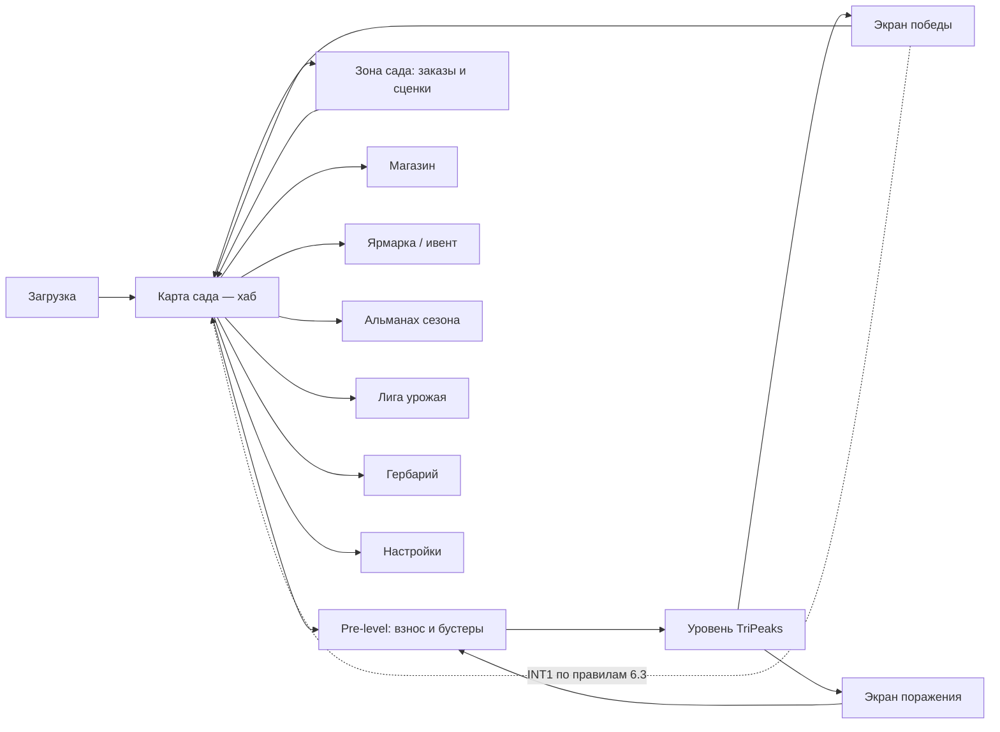

# 07. UX / UI / FTUE

**Проект:** Orchard Peaks. Назад: [06-monetization.md](06-monetization.md) · Далее: [08-liveops.md](08-liveops.md)

Дизайн-принцип всей главы: игрок 58 лет с Android среднего класса и очками для чтения в другой комнате должен пройти всё без напряжения. Если решение хорошо для неё — оно хорошо для всех.

---

## 7.1. Карта экранов

Правила навигации:

- Глубина от хаба до любого экрана — 1 тап. Возврат — всегда одна кнопка «домой» в одном и том же углу.
- Никаких горизонтальных каруселей меню и жестов-шорткатов как единственного пути: всё достижимо явными кнопками.
- Максимум 1 попап при входе в игру (очередь офферов с приоритетами; остальное — бейджи на кнопках). Grand Harvest с его 4–6 попапами на вход — антиреференс.

## 7.2. Wireframe-описания ключевых экранов

### Карта сада (хаб)

- Центр (60% экрана): текущая зона сада с живыми объектами; крупная кнопка **«Играть — уровень 51»** внизу по центру (высота ≥ 64 pt, полная ширина минус поля).
- Верхняя панель: баланс монет (слева, с «+», ведущим в Кошелёк/магазин), урожай, стрик.
- Правый край, вертикально: Ярмарка (в дни ивента), Альманах, Лига, Гербарий — иконки 56 pt с текстовыми подписями (только иконок недостаточно для ЦА).
- Нижний край: Сад (заказы, с бейджем числа доступных), Магазин, Настройки.

### Pre-level

- Карточка уровня: номер, взнос E(n) крупно, 8–14 иконок наград (урожай/золотые карты).
- Три слота бустеров с ценами; перед «камнем» — верхний слот подсвечен и бесплатен за rewarded (RW3).
- Кнопки: «Играть» (главная), «Назад». Если баланс < E(n): кнопка мутирует в «Пополнить» → Кошелёк (RW6) + полка.

### Уровень (core)

- Стол занимает 70% высоты; карты 15–20% крупнее генре-нормы; индексы карт в двух углах, увеличенный кегль.
- Низ: сток (с числом оставшихся карт цифрой), карта сброса по центру, ундо и джокер справа.
- Верх: тонкая полоса — прогресс очистки стола, счётчик серии, собранный урожай, пауза.
- Ничего мигающего; серия ×2+ отмечается мягким золотым свечением сброса.

### Экран победы

Последовательность фиксированная, без пропуска наград: 1) конфетти 1,5 с (отключаемо) → 2) монеты за уровень + бонус стока начисляются с анимацией счётчика → 3) урожай ссыпается в корзину → 4) оффер RW2 «Удвоить монеты?» (большая кнопка с иконкой видео + «Нет, спасибо» обычной кнопкой, не микроссылкой) → 5) прогресс заказа сада → 6) возврат на карту (здесь возможен INT1 по правилам [06-monetization.md](06-monetization.md) п. 6.3).

### Экран поражения

Тёплый тон: Бисквит с опущенными ушами, «Почти получилось — стол был чист на 78%». Кнопки: «Ещё раз» (главная), «На карту». Урожай, собранный в попытке, показан как сохранённый. Никакой рекламы ([03-core-gameplay.md](03-core-gameplay.md) п. 3.6).

### Магазин

Одна вертикальная лента: сверху remove-ads/подписка (честный блок «что входит»), затем паки по возрастанию. Каждый пак: крупная цена, содержимое иконками с числами, без зачёркнутых «старых цен» на постоянной полке (только в честных временных офферах с таймером ≥ 24 ч).

## 7.3. FTUE — первые 5 минут по шагам

Цель: победа раньше первой развилки, сад раньше магазина, первый rewarded до конца сессии 1, interstitial — не раньше дня 2 ([06-monetization.md](06-monetization.md) п. 6.3).

| Время | Шаг | Обучение | Монетизация |
|---|---|---|---|
| 0:00–0:15 | Сплэш → сразу уровень 1 (без меню, без регистрации, ATT-промпт отложен) | — | — |
| 0:15–1:00 | Уровень 1 (12 карт, гарантированная победа при любых ходах). Рука-подсказка на первые 2 хода; правило «±1» одной строкой текста | Тап по карте, сброс | — |
| 1:00–1:30 | Победа, начисление монет крупно; первая сценка (15 с): письмо тёти Марты, знакомство с Бисквитом | Эмоциональный крючок | — |
| 1:30–1:50 | Сад: первый заказ «расчистить крыльцо» — 1 тап, мгновенная трансформация | Урожай → заказы | — |
| 1:50–3:00 | Уровень 2 (сток и добор; 1 закрытая стопка) | Сток, серия | — |
| 3:00–4:15 | Уровень 3: карты урожая («соберите яблоки прямо на столе») | Мета-ресурс в core | — |
| 4:15–4:45 | Победа уровня 3 → **первый rewarded-оффер RW2 «Удвоить монеты?»** с подписью «посмотрите короткое видео» | Знакомство с rewarded как с подарком | RW2 |
| 4:45–5:30 | Заказ №2 + выбор декорации (1 из 3) | Design-мотивация | — |
| 5:30+ | Уровень 4 с подаренным джокером; далее свободная игра. ATT-промпт — после победы уровня 5, с пре-промптом «реклама станет полезнее» | Джокер | — |
| День 2+ | Первый interstitial после уровня ≥ 12 и ≥ 24 ч ([06-monetization.md](06-monetization.md)) | — | INT1 |
| День 3–21 | Starter pack $2,99 всплывает при первом входе в дефицитный день ([05-economy.md](05-economy.md) п. 5.7) | — | IAP |

Гейты качества FTUE (замер в soft launch, события `ftue_step` — [09-analytics-kpi.md](09-analytics-kpi.md)): завершение шага «уровень 3» ≥ 85% установивших; медианное время до первого rewarded ≤ 6 мин; ATT-opt-in ≥ 30% (пре-промпт поднимает над средними ~27%).

## 7.4. Доступность (accessibility) — обязательные требования

| Область | Требование |
|---|---|
| Шрифты | Базовый кегль ≥ 18 pt эквивалент; поддержка системного Dynamic Type / Font Scale до 130% без ломки лейаутов; без light-начертаний |
| Контраст | Текст и индексы карт ≥ 4.5:1 (WCAG AA); проверка на жёлто-акварельных фонах обязательна |
| Дальтонизм | Масти различаются формой, а не только цветом; режим «высокий контраст карт» (чёрно-белые упрощённые рубашки) в настройках; палитры зон проверяются симуляцией протанопии/дейтеранопии |
| Моторика | Цели тапа ≥ 88×88 pt; нет двойных тапов, лонг-прессов и драгов в критическом пути; ундо прощает дрожание руки |
| Темп | Нигде нет таймеров и исчезающих кнопок; любые попапы закрываются явным крестом ≥ 44 pt; автоскрытий нет |
| Звук | Полное дублирование аудиосигналов визуальными; игра полноценна в беззвучном режиме |
| Прерывания | Мгновенное сохранение состояния уровня; звонок/сворачивание не стоят прогресса ([03-core-gameplay.md](03-core-gameplay.md) п. 3.3) |
| Локализация | EN на запуске; DE/FR/ES — Проход Е; строки без сокращений и аббревиатур («ур.», «lvl» запрещены) |
| Онбординг настроек | При первом входе в настройки — пресет «Крупный текст и карты» одним переключателем |

## 7.5. Тон UI-текстов

- Обращение тёплое, без сюсюканья: «Отличная серия!», не «Вау, супер-мега!».
- Числа всегда конкретны: «+540 монет», не «куча монет».
- Отказ от рекламы/покупки — всегда полноценная кнопка «Нет, спасибо», без чувства вины («Вы уверены, что хотите отказаться от подарка?» — запрещено).
- Слова «казино», «ставка», «джекпот» запрещены во всех текстах и креативах (взнос за уровень называется «билет в сад»).

## 7.6. UX-исследования (план)

1. Проход А ([10-production.md](10-production.md)): 8 модерируемых сессий с ЦА 50+ (US/UK remote-панель) на прототипе FTUE; критерий — 8/8 доходят до уровня 4 без помощи модератора.
2. Проход В: немодерируемый тест магазина и Кошелька (задача «купите комфорт на 3 дня» — понимание полки).
3. Проход Г: когортный анализ `ftue_step` + записи сессий (обезличенные heatmaps тапов) — поиск «мёртвых» зон тапа на дешёвых Android.
