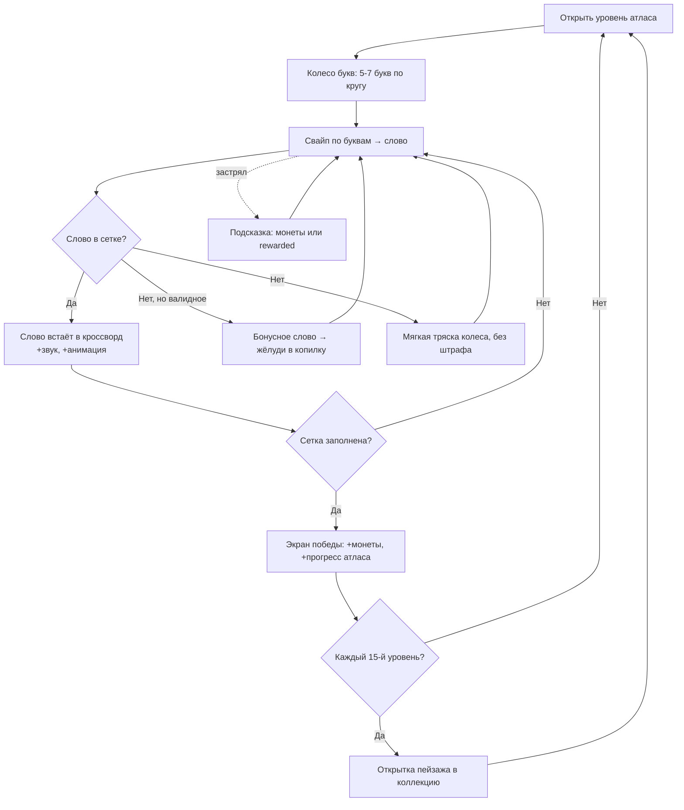

# 03 — Ядро геймплея

Документ: спецификация core-геймплея WordGrove. Владелец: ГД. Версия 1.0.

Связанные главы: [04-meta-progression.md](04-meta-progression.md) · [05-economy.md](05-economy.md) · [07-ux-ui-ftue.md](07-ux-ui-ftue.md)

---

## 1. Core loop



Петля второго порядка (мета): уровни → открытки → регионы атласа → сезонный трек. См. [04-meta-progression.md](04-meta-progression.md).
Петля монетизации: застревание → подсказка → монеты/rewarded → дефицит монет → IAP/подписка. См. [05-economy.md](05-economy.md), [06-monetization.md](06-monetization.md).

## 2. Полные правила

### 2.1 Состав уровня

- **Колесо букв:** 5–7 букв (FTUE: 4), расположены по кругу. Буквы могут повторяться («Т», «Т», «О», «С» для «СТО», «ТОСТ»...).
- **Сетка-кроссворд:** 3–9 целевых слов, пересекающихся по правилам кроссворда (общие буквы на пересечениях). Размер сетки от 5×5 до 9×9 клеток.
- **Целевые слова:** все составляются ТОЛЬКО из букв колеса (каждая буква колеса используется в слове не больше раз, чем присутствует на колесе).
- **Бонусные слова:** валидные словарные слова из букв колеса, не входящие в сетку. Дают 2 жёлудя каждое (см. [05-economy.md](05-economy.md)). Повторный ввод найденного слова — нейтральная анимация, без наград.

### 2.2 Ввод

- Свайп пальцем по буквам колеса: линия соединяет буквы, текущее слово отображается крупно над колесом.
- Отпустил палец → слово отправлено на проверку.
- Альтернативный ввод (доступность, 50+): тап-режим — последовательные тапы по буквам + кнопка «OK». Включается в настройках, предлагается автоматически, если игрок трижды «сорвал» свайп.
- Кнопка «перемешать» (бесплатно, без лимита) — пересортировка букв на колесе; главный бесплатный инструмент против застревания.

### 2.3 Валидация слов

- Слово валидно, если есть в игровом словаре (см. раздел 5) и длина ≥ 3.
- Регистронезависимо; для RU: «е»=«ё» при вводе, в сетке отображается каноничная форма.
- Обсценная и оскорбительная лексика: в словаре валидации отсутствует (чёрный список), в сетках не встречается никогда.

### 2.4 Подсказки (расходники)

| Подсказка | Действие | Цена (монеты) | Альтернатива |
|-----------|----------|---------------|--------------|
| Лампа | Открывает случайную букву в сетке | 100 | 1 бесплатная за rewarded, 1 раз за уровень |
| Прицел | Игрок тапает конкретную клетку — открывается она | 150 | — |
| Ракета | Открывает 5 случайных букв по всей сетке | 350 | редкий дроп из ивентов |

Цены и earn-rate сбалансированы в [05-economy.md](05-economy.md). У подписчиков Лампа безлимитна с кулдауном 3 мин ([06-monetization.md](06-monetization.md), раздел 5).

### 2.5 Победа и награды

- Уровень завершён, когда все целевые слова открыты (подсказками или вводом — неважно).
- Награда: 20–25 монет (формула в [05-economy.md](05-economy.md)) + жёлуди за бонусные слова + прогресс атласа.
- «Блестящий проход» (без единой подсказки): +5 монет и звёздочка на уровне в атласе (коллекционный слой для Achiever-мотивации).

## 3. Fail states и механики спасения

Жёсткого фейла в ядре **нет** — это принципиально для релакс-позиционирования ([01-concept.md](01-concept.md), раздел 4). Но есть состояния фрустрации, каждое со своим спасением:

| Состояние | Детект | Спасение |
|-----------|--------|----------|
| Застревание (нет ввода 60 сек) | Таймер бездействия | Подсветка колеса пульсацией; на 90 сек — тултип «Попробуй перемешать» |
| Застревание глубокое (120 сек или 5 невалидных слов подряд) | Счётчики | Оффер бесплатной Лампы за rewarded (плейсмент RV-1, [06-monetization.md](06-monetization.md)) |
| Осталось 1 слово, 180 сек | Состояние сетки | «Почти получилось!» + первая буква слова подсвечивается бесплатно (1 раз за уровень) |
| Нет монет на подсказку | Балансовый чек в момент тапа | Мягкий пейволл: rewarded ИЛИ магазин ИЛИ «вернись к перемешиванию» — всегда 3 выхода, никогда тупик |
| Серия сложных уровней → отток | 3 уровня подряд с временем > p75 | Динамическая сложность: следующий уровень берётся на 1 бакет легче (см. раздел 6.3) |

## 4. Сессия игрока по минутам (референсная, D7+, персона «Линда»)

| Время | Событие | Монетизационные точки |
|-------|---------|----------------------|
| 0:00 | Запуск → сплэш → главный экран, бейдж daily | — |
| 0:15 | Daily-кроссворд дня (бесплатная часть) | Баннер выключен на daily |
| 3:30 | Daily решён → стрик-календарь +1 → колесо бонуса | RV-3: «крутани ещё раз» (rewarded) |
| 4:00 | Уровень атласа N | Баннер снизу (только не-подписчики, с ур. 11) |
| 6:30 | Уровень N решён | Interstitial I-1 (если кап позволяет) → экран победы |
| 6:45 | Экран победы | RV-2: «удвоить монеты» (rewarded) |
| 7:00 | Уровень N+1, застревание на 4-м слове | RV-1: бесплатная Лампа за rewarded |
| 10:30 | Уровень N+1 решён, открытка получена | Interstitial I-1 (кап: ≥3 мин с прошлого) |
| 11:00 | Экран коллекции открыток, выход | Пуш-план на вечер: [08-liveops.md](08-liveops.md) |

Целевая сессия: 8–12 мин, 2–3 сессии/день. За сессию: 2–3 interstitial, 1–2 rewarded — согласовано с капами в [06-monetization.md](06-monetization.md), раздел 3.

## 5. Генерация контента: словари и паззлы

### 5.1 Словарные источники

| Язык | Словарь валидации (широкий) | Словарь генерации (частотный) | Объём после фильтра 3–8 букв |
|------|------------------------------|-------------------------------|------------------------------|
| EN | ENABLE/SCOWL (открытые лицензии) минус чёрный список | Топ ~20 тыс. лемм по частотному корпусу (wordfreq) | ~80 тыс. валидация / ~12 тыс. генерация |
| RU | OpenCorpora-леммы минус чёрный список | Частотный словарь Ляшевской–Шарова, топ ~15 тыс. | ~60 тыс. валидация / ~10 тыс. генерация |

Два словаря на язык — ключевое решение: **валидация щедрая** (игрок радуется, что «его» слово принято — бонусные жёлуди), **генерация строгая** (в сетке только слова, которые знает средний игрок; никаких «ЭРЛ» и «АБАЗ», за которые ненавидят конкурентов).

### 5.2 Алгоритм генерации уровня

```
1. ВЫБОР БАЗЫ: взять базовое слово W длины 5-7 из словаря генерации
   (частотный ранг соответствует целевому баккету сложности).
2. ПОДМНОЖЕСТВА: перечислить все слова словаря генерации, составимые
   из мультимножества букв W, длина >= 3. Получаем кандидатов C.
3. ФИЛЬТР: убрать редкие (частотный ранг > порога баккета), формы-дубли
   (для RU: не класть в одну сетку "СТОЛ" и "СТОЛЫ").
4. ОТБОР СЛОВ СЕТКИ: выбрать 3-9 слов из C жадным алгоритмом с максимизацией
   пересечений букв (каждое новое слово должно пересекаться хотя бы с одним уже выбранным).
5. УКЛАДКА: backtracking-раскладка выбранных слов в кроссвордную сетку
   (горизонтали/вертикали, пересечения по общим буквам, компактный bounding box <= 9x9).
   Если укладка не найдена за K=500 итераций — вернуться к шагу 4 с другим подмножеством.
6. БОНУС-СЛОВА: все слова словаря ВАЛИДАЦИИ из букв W, не попавшие в сетку,
   записываются в bonus-список уровня.
7. СКОРИНГ: посчитать Difficulty (раздел 6.1), присвоить баккет.
8. СЕРИАЛИЗАЦИЯ: JSON {wheel, grid, words, bonus, difficulty} → пакет уровней.
```

Генерация офлайновая (Node.js-скрипт в CI, см. [10-production.md](10-production.md)): игра получает готовые пакеты по 100 уровней, ничего не генерирует на устройстве. Паззлы детерминированы → воспроизводимость багов и честное сравнение в A/B.

### 5.3 QA контента

- Автотесты пайплайна: связность сетки, решаемость, отсутствие слов чёрного списка, лимиты размеров.
- Ручное сэмплирование: лингвист-контентщик просматривает 5% сгенерированных уровней каждого пакета + 100% ежедневных премиум-кроссвордов (они полу-ручные: тема задаётся редактором, генератор предлагает, редактор курирует).
- Телеметрия как QA: уровни с solve-time p50 вне коридора баккета или completion < 92% автоматически попадают в отчёт на переделку ([09-analytics-kpi.md](09-analytics-kpi.md), событие `level_finish`).

## 6. Кривая сложности

### 6.1 Формула сложности уровня

```
Difficulty = 0.35 * R_letters + 0.30 * F_words + 0.20 * N_norm + 0.15 * L_norm

R_letters — средняя редкость букв колеса (частота буквы в языке, нормированная 0..1,
            редкие буквы Q/Z/Щ/Ф дают высокие значения)
F_words   — средний нормированный частотный ранг слов сетки (реже слово — выше значение)
N_norm    — число слов сетки, нормированное: (N - 3) / 6      (3 слова → 0, 9 слов → 1)
L_norm    — средняя длина слова, нормированная: (Lavg - 3) / 4 (3 → 0, 7 → 1)
```

Difficulty ∈ [0..1] → 5 баккетов: D1 «разминка» [0–0,25), D2 [0,25–0,45), D3 [0,45–0,6), D4 [0,6–0,75), D5 «вызов» [0,75–1]. Калибровка весов — по телеметрии soft launch (регрессия solve-time на компоненты формулы).

### 6.2 Кривая по номеру уровня

```
TargetDifficulty(n) = Dmin + (Dmax - Dmin) * (1 - e^(-n / 120)) + Sawtooth(n)

Dmin = 0.10, Dmax = 0.62 (средняя асимптота — НЕ максимум: релакс-игра)
Sawtooth(n): внутри каждой десятки уровней паттерн баккетов
             [−1, 0, 0, +1, 0, −1, 0, +1, 0, +2] относительно базового баккета,
             т.е. каждый 10-й уровень — "пик" (уровень-вызов D+2, максимум D5),
             сразу после пика — лёгкий "отдых" (D−1).
```

Смысл: экспонента даёт быстрый рост интереса в первые 100 уровней и пологое плато дальше (игрок 50+ не должен упереться в стену на уровне 300); пила даёт ритм «напряжение—разрядка», пики создают спрос на подсказки (точки дефицита — [05-economy.md](05-economy.md), раздел 7).

### 6.3 Динамическая подстройка (DDA)

- Скользящее окно 5 уровней: если у игрока 3+ уровня с временем > p75 баккета ИЛИ 2+ выхода из уровня без завершения → следующие 2 уровня подаются из баккета на 1 ниже.
- Если 5 уровней подряд с временем < p25 и без подсказок → +1 баккет на следующие 2 уровня.
- DDA не трогает уровни-пики (каждый 10-й) и ежедневный кроссворд — там сложность фиксированная, это «честные» испытания.
- DDA-параметры — remote config, тесты в плане A/B ([09-analytics-kpi.md](09-analytics-kpi.md), раздел 6).

### 6.4 FTUE-рампа (уровни 1–10)

| Уровни | Букв на колесе | Слов в сетке | Баккет | Обучение |
|--------|----------------|--------------|--------|----------|
| 1 | 4 | 2 | D1 | Свайп (рука-подсказка ведёт первое слово) |
| 2–3 | 4–5 | 3 | D1 | Бонусное слово (подстроено: гарантированно есть очевидное) |
| 4 | 5 | 4 | D1 | Кнопка «перемешать» |
| 5 | 5 | 4 | D2 | Первый rewarded-оффер: «удвоить монеты» (RV-2) |
| 6 | 5–6 | 5 | D2 | Первый interstitial после победы (I-1) |
| 7–9 | 6 | 5–6 | D2 | Подсказка Лампа (выдана бесплатно, обучение трате) |
| 10 | 6 | 6 | D3 | Первый «пик» + открытка → экран коллекции → тизер подписки |

Полный FTUE-сценарий с экранами — в [07-ux-ui-ftue.md](07-ux-ui-ftue.md), раздел 4.

## 7. Технические требования ядра (для [10-production.md](10-production.md))

- Уровень = чистые данные (JSON ≤ 2 КБ); движок рендерит любой уровень из данных — контент отделён от кода.
- Офлайн-игра: минимум 200 уровней в бандле, догрузка пакетов по Wi-Fi; реклама с офлайн-фолбэком (пропуск показа без крэша).
- Время загрузки уровня < 1 сек на mid-range Android 2022; вся сессия ядра работает при 0% сети.
- Полная детерминированность уровня по его JSON — обязательна для A/B контента и воспроизведения багов.
