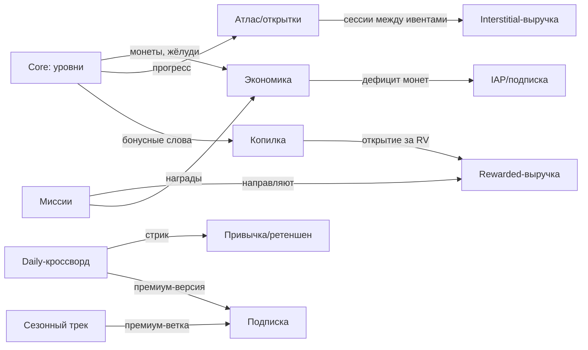

# 04 — Мета-игра и прогрессия

Документ: спецификация мета-слоёв WordGrove. Владелец: ГД. Версия 1.0.

Связанные главы: [03-core-gameplay.md](03-core-gameplay.md) · [05-economy.md](05-economy.md) · [08-liveops.md](08-liveops.md)

---

## 1. Принципы меты

1. **Мета обслуживает ретеншен, а не наоборот.** 89% рекламной выручки игрока набирается за первые 7 дней — каждый мета-слой обязан иметь понятный вклад в D1–D7 или D30.
2. **Ноль давления.** Никаких «жизней», энергий и таймеров, блокирующих игру. Дефицит создаётся только вокруг подсказок и премиум-контента ([05-economy.md](05-economy.md), раздел 7).
3. **Слои включаются постепенно** (по уровням и дням), чтобы не перегрузить FTUE — расписание в разделе 8.

## 2. Карта слоёв прогрессии

| Слой | Открывается | Мотивация (QF) | Работает на | Связь с монетизацией |
|------|------------|----------------|-------------|----------------------|
| Атлас (регионы и уровни) | Сразу | Completion | D1–D30 | Interstitial-точки между уровнями |
| Коллекция открыток | Уровень 10 | Completion/Collection | D7–D90 | Дубли открыток → жёлуди; ускорение — rewarded |
| Ежедневный кроссворд + стрик | День 2 | Habit/Completion | D1–D365 | Ядро ценности подписки (премиум-версия) |
| Копилка жёлудей | Уровень 8 | Collection | D7+ | Открывается rewarded-видео (RV-5) |
| Миссии (daily/weekly) | Уровень 12 | Achievement | D7–D30 | Направляют в rewarded-плейсменты |
| Сезонный трек (4 недели) | Уровень 20 / день 4 | Achievement | D30+ | Премиум-ветка — часть подписки |
| Лига по жёлудям (опц.) | Уровень 25 | Competition-лайт | D14+ | Косвенно: больше сессий → больше показов |
| Ивенты выходного дня | По календарю | Novelty | Возвраты | Билеты, rewarded-энтры ([08-liveops.md](08-liveops.md)) |

## 3. Слои подробно

### 3.1 Атлас

- Прогрессия: уровни сгруппированы в «локации» по 15 уровней (= 1 открытка), локации — в «регионы» по 60 уровней (= смена фонового пейзажа и палитры).
- На карте атласа видны: текущая локация, % заполнения, звёздочки «блестящих проходов» ([03-core-gameplay.md](03-core-gameplay.md), раздел 2.5).
- Контента на старте: 1200 уровней (20 регионов) — при среднем темпе 8 уровней/день это 150 дней контента; пайплайн генерации даёт +600 уровней/мес силами 0,5 FTE лингвиста ([10-production.md](10-production.md)).

### 3.2 Коллекция открыток

- Каждые 15 уровней — открытка локации (арт пейзажа + 1 этимологический факт о слове региона: Explorer-мотивация).
- Альбом открыток: сетки по регионам, шеринг открытки (виральная точка, см. раздел 5).
- Завершение альбома региона: +300 монет + рамка профиля.
- Открытки НЕ продаются за деньги — коллекция должна оставаться «честной» (доверие аудитории 45+ — часть позиционирования, [01-concept.md](01-concept.md), раздел 8).

### 3.3 Ежедневный кроссворд и стрик

- Один кроссворд в день, 7×7, тема дня («Кухня», «Осень», «Кино 80-х»), сложность фиксированная D3.
- Стрик-календарь: месяц с отметками; вехи 3/7/14/30 дней → награды (см. таблицу earn в [05-economy.md](05-economy.md)).
- Заморозка стрика: 1 бесплатная/мес; дополнительная — 500 монет или rewarded ×3 (RV-6); подписчикам — авто-заморозка до 3 дней.
- **Премиум-кроссворд дня** (только подписка): вторая, курируемая редактором сетка 9×9 с «изюминкой» (слова-тезки, мини-история). Это контентное ядро подписки — [06-monetization.md](06-monetization.md), раздел 5.
- Пропущенные дни: архив последних 7 daily доступен подписчикам; не-подписчикам — вчерашний за rewarded (RV-4).

### 3.4 Копилка жёлудей

- Жёлуди капают за бонусные слова (2/слово) и часть миссий — копятся в «копилку» с капом 200.
- Полная копилка открывается ТОЛЬКО просмотром rewarded (RV-5) → конвертация в монеты 1:1. Не хочешь смотреть — копилка стоит полной, новые жёлуди сгорают: мягкое, но ощутимое подталкивание (референс: piggy-механики casual-жанра).
- Подписчикам копилка открывается бесплатно (ещё один пункт value-листа подписки).

### 3.5 Миссии

- Daily (3 шт., ротация): «Найди 5 бонусных слов», «Пройди 3 уровня», «Пройди уровень без подсказок» → 30–60 монет.
- Weekly (3 шт.): «20 уровней», «Стрик 5 дней», «2 блестящих прохода» → 150–250 монет + жёлуди.
- Дизайн-правило: минимум одна daily-миссия в день органично проходит через rewarded-плейсмент (например, «Открой полную копилку») — миссии дирижируют рекламной воронкой, поднимая rewarded/DAU к целевым 1,5 ([06-monetization.md](06-monetization.md), раздел 8).

### 3.6 Сезонный трек

- Сезон = 4 недели, 30 ступеней, валюта трека — «листья» (за уровни, daily, миссии).
- Бесплатная ветка: монеты, Лампы, 1–2 открытки-эксклюзива.
- Премиум-ветка (входит в подписку, отдельно НЕ продаётся в v1.0): ×2 монеты трека, эксклюзивная тема оформления, Ракеты.
- Решение «премиум-трек только в подписке» — сознательное: упрощаем полку и делаем подписку единственным премиум-статусом (тест альтернативы — в плане A/B, [09-analytics-kpi.md](09-analytics-kpi.md), M4).

### 3.7 Лига (опциональный соревновательный слой)

- Еженедельная лига 30 человек по жёлудям; бронза→серебро→золото; топ-10 — монеты.
- Вход добровольный (тумблер в настройках, по умолчанию ВКЛ, но без пушей о лиге до первого открытия экрана).
- Осознанно лайтовая: аудитория Bartle-Achiever/Explorer, Killers нет ([01-concept.md](01-concept.md), раздел 5.2). Если телеметрия покажет < 15% открываемости экрана лиги к D14 — слой замораживаем (kill-критерий в [09-analytics-kpi.md](09-analytics-kpi.md)).

## 4. Ивентовые механики

Календарь и расписание — в [08-liveops.md](08-liveops.md). Здесь — механики:

| Ивент | Механика | Длительность | Экономика |
|-------|----------|--------------|-----------|
| «Марафон слов» (уикенд) | Счётчик слов за 48 ч, 3 порога наград | Сб–Вс | Бесплатно; ускорение — rewarded ×2 прогресса (RV-7, ивентовый) |
| «Тематическая неделя» | 7 связанных daily-кроссвордов одной темы, финальная мега-открытка | 7 дней | Пропущенный день догоняется за 300 монет |
| «Охота за словом» | Секретное слово недели спрятано среди бонусных слов уровней | 7 дней | Нашёл — 500 монет; подсказка-намёк за rewarded |
| «Двойные жёлуди» | ×2 жёлудей за бонусные слова | 24 ч, в дни просадки DAU | Разгоняет RV-5 (копилка наполняется вдвое быстрее) |

Правило нагрузки: не более 1 активного ивента одновременно + daily-кроссворд. Аудитория 45+ негативно реагирует на «ёлку» из баннеров ивентов (уроки Crossword Jam, [02-market.md](02-market.md), раздел 2.1).

## 5. Социальный слой (минимальный, v1.x)

- Шеринг открытки/стрика картинкой (системный share sheet) — органическая петля, ноль соцграфа внутри игры.
- «Слово другу» (v1.2+): отправить другу ссылку-вызов на конкретный daily; друг видит твоё время. Deep link → инсталл-атрибуция (органика).
- Никакого чата/UGC — модерация не окупается на нашей ЦА, риски сторов.

## 6. Как мета связана с core loop и монетизацией

Каждый мета-слой имеет ровно одну основную монетизационную роль (см. таблицу раздела 2) — это проверяется на ревью фич: слой без роли в ретеншене или монетизации не строим.

## 7. Экраны меты

Полная карта экранов и вайрфреймы — [07-ux-ui-ftue.md](07-ux-ui-ftue.md). Мета добавляет: Атлас (хаб), Альбом открыток, Daily-хаб со стрик-календарём, Сезонный трек, Лига, Миссии (шторка на главном экране).

## 8. Расписание включения слоёв (анти-перегруз FTUE)

| Триггер | Что включается | Почему здесь |
|---------|----------------|--------------|
| Уровень 8 | Копилка жёлудей | Игрок уже находил бонусные слова — механика понятна мгновенно |
| Уровень 10 | Первая открытка + альбом | Первая «вау»-награда до первого пика сложности |
| День 2 (первый вход нового дня) | Daily-кроссворд + стрик | Формирование привычки со 2-го дня — критично для D7 |
| Уровень 12 | Миссии | Появляется выбор «что делать сегодня» |
| Уровень 12 / День 2 | Полноценный оффер подписки | После того как игрок увидел daily и рекламу — value очевиден ([07-ux-ui-ftue.md](07-ux-ui-ftue.md), раздел 4.3) |
| Уровень 20 | Сезонный трек | К этому моменту виден горизонт «играть недели» |
| Уровень 25 | Лига | Только для втянувшихся |

KPI-эффекты каждого слоя и события трекинга — [09-analytics-kpi.md](09-analytics-kpi.md), разделы 2–3.
