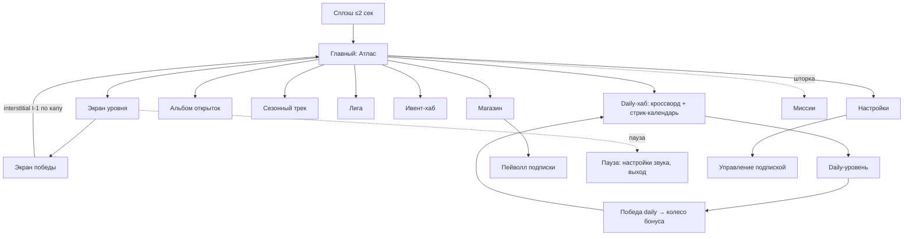

# 07 — UX/UI и FTUE

Документ: UX-спецификация WordGrove. Владелец: UX/UI-дизайнер + ГД. Версия 1.0.

Связанные главы: [03-core-gameplay.md](03-core-gameplay.md) · [04-meta-progression.md](04-meta-progression.md) · [06-monetization.md](06-monetization.md)

---

## 1. Карта экранов и переходов

Правила навигации: с любого экрана до геймплея ≤ 2 тапа; кнопка «назад» (Android) всегда ведёт на предыдущий экран, никогда — в рекламу; счётчик монет виден на всех экранах кроме уровня daily (там чистый режим).

## 2. Вайрфреймы ключевых экранов (описания)

### 2.1 Главный экран (Атлас)

- Верх: полоса статуса — монеты (слева), стрик-огонёк с числом (центр), аватар/настройки (справа).
- Центр (70% высоты): пейзаж текущей локации, крупная кнопка **«Уровень N ▶»** (min 64 dp высоты), под ней прогресс локации «7/15» и миниатюры звёзд.
- Низ: док из 5 иконок — Daily (с бейджем-точкой до прохождения), Альбом, ИГРАТЬ (центр, дублирует кнопку), Сезон, Магазин. Ивент — временный баннер-плашка над доком (одна, не более).
- Шторка миссий: свайп вниз от верхней полосы или тап по огоньку.

### 2.2 Экран уровня

- Верх 55%: сетка кроссворда, автоскейл под размер сетки; открытые буквы контрастные, с анимацией «вписывания».
- Низ 45%: колесо букв (диаметр ≥ 60% ширины экрана), над ним — строка текущего ввода крупным кеглем.
- Слева от колеса: вертикальный столбик подсказок — Лампа (с ценой 100 или значком rewarded, если доступна бесплатная), Прицел 150, Ракета 350. Справа: «перемешать» и счётчик жёлудей уровня.
- Баннер B-1: строго под колесом, adaptive, отступ ≥ 24 dp от зоны свайпа (анти-мисклик — обязательное требование, случайные клики руинят ретеншен и качество трафика для сетей).
- Никаких таймеров и движущихся элементов вне анимаций отклика.

### 2.3 Экран победы

- Последовательность (каждый шаг — тап или авто через 1,2 сек): слова разлетаются в сетку → «+22 монеты» с полётом в счётчик → жёлуди уровня в копилку (виден уровень заполнения копилки) → кнопки.
- Кнопки: **«Дальше»** (основная) и **«×2 монеты ▶🎬»** (RV-2, вторичная, но визуально тёплая). После RV-2 interstitial не показывается (правило 4 из [06-monetization.md](06-monetization.md), раздел 4).
- Каждый 15-й уровень: сюда встраивается церемония открытки (полноэкранная, шеринг-кнопка).

### 2.4 Daily-хаб

- Календарь месяца с отметками стрика; сегодняшний день пульсирует.
- Карточка «Кроссворд дня: {Тема}» → уровень. Ниже — карточка «Премиум-кроссворд: {Тема}» с замком-короной для не-подписчиков (тап → пейволл) — ежедневная витрина подписки.
- Полное отсутствие баннеров и interstitial в этой ветке ([06-monetization.md](06-monetization.md), правило 5).

### 2.5 Пейволл подписки

- Заголовок: «Кроссворды без рекламы. Каждый день — особенный.»
- Список из 4 главных ценностей (не всех 9): без рекламы · премиум-кроссворд дня · безлимит Ламп · защита стрика. Ссылка «все преимущества» разворачивает полный список.
- Планы: Год $49,99 (бейдж «−54%», предвыбран) · Месяц $8,99 · строка триала «7 дней бесплатно, отмена в любой момент».
- Вторичная ссылка внизу: «Только убрать рекламу — $9,99» (Remove Ads).
- Закрытие — явный крестик в углу, доступен сразу (никаких задержек крестика: доверие 45+ дороже 0,1 п.п. конверсии).

### 2.6 Магазин

- Верхний блок: карточка подписки (постоянная). Далее: стартовый набор (если не куплен) → сетка монетных SKU по возрастанию ([06-monetization.md](06-monetization.md), раздел 5.3). Внизу — Remove Ads.
- Цены всегда в локальной валюте стора; никаких зачёркнутых «фейковых» цен.

## 3. UX-принципы ввода

- Свайп-трек: линия толщиной 8 dp, каждая захваченная буква подсвечивается + лёгкая вибрация (отключаемая).
- Промах-толерантность: захват буквы по радиусу 1,3× визуального (пальцы 50+, тремор).
- Тап-режим ввода (доступность): автопредложение после 3 сорванных свайпов, запоминается ([03-core-gameplay.md](03-core-gameplay.md), раздел 2.2).
- Отмена ввода: провести палец в центр колеса.

## 4. FTUE — первые 5 минут по шагам

### 4.1 Хронометраж

| Время | Шаг | Обучение/событие | Монетизация |
|-------|-----|-------------------|-------------|
| 0:00 | Сплэш → сразу уровень 1 (БЕЗ главного экрана, без регистрации, без выбора языка — берём язык системы) | Рука-подсказка ведёт свайп первого слова «SUN» | — |
| 0:40 | Уровень 1 (2 слова) завершён | Первый экран победы, полёт монет | — |
| 1:10 | Уровень 2: игрок сам вводит | Тултип при первом бонусном слове: «+2 жёлудя!» | — |
| 2:10 | Уровень 3 | Без подсказок интерфейса — проверка усвоения | — |
| 3:00 | Уровень 4 | Обучение «перемешать» | — |
| 3:50 | Уровень 5 завершён | — | **Первый rewarded-оффер** RV-2 «×2 монеты» — добровольный, с иконкой 🎬 и подписью «видео ~30 сек» |
| 4:40 | Уровень 6 завершён | — | **Первый interstitial** I-1 (после победы, с шансом уже увиденного RV — порядок именно такой: сначала добровольный формат, потом принудительный) |
| 5:00+ | Уровень 7: выдача 2 Ламп, обучение подсказке | Первая трата | — |

### 4.2 Правила FTUE

- До уровня 6 — ноль принудительной рекламы; до уровня 5 — ноль любых офферов.
- Уровни 1–3 генерируются из «золотого» пула (вручную отобраны: очевидные слова, гарантированное лёгкое бонусное слово на ур. 2).
- Первый запуск работает полностью офлайн (уровни в бандле, [03-core-gameplay.md](03-core-gameplay.md), раздел 7).
- Пропускаемость: вся рука-подсказка исчезает при любом правильном действии игрока раньше подсказки.

### 4.3 Дни 1–2 (расширенный FTUE)

- Ур. 8: копилка. Ур. 10: открытка + альбом + **мягкий тизер подписки** (одна карточка «в Club — премиум-кроссворд каждый день», кнопка «позже» равнозначна по размеру).
- День 2, первый вход: Daily-хаб, стрик-день 1 → после решения — **полный пейволл** (первый и единственный автопоказ; далее пейволл только по контекстным триггерам из [06-monetization.md](06-monetization.md), раздел 5.1).
- Ур. 12: миссии.

KPI FTUE: завершение ур. 1 ≥ 95%, ур. 5 ≥ 85%, ур. 10 ≥ 70% от стартовавших сессию (события `ftue_step` — [09-analytics-kpi.md](09-analytics-kpi.md), раздел 2).

## 5. Доступность (ядро продукта, не чекбокс)

| Область | Требование |
|---------|-----------|
| Шрифты | Буквы колеса ≥ 28 pt; сетка ≥ 20 pt; UI-текст ≥ 16 pt; систем­ный масштаб текста поддерживается до 130% без ломки лейаута |
| Контраст | WCAG 2.1 AA минимум (4,5:1) для всего текста; проверка на каждом фоне-пейзаже автотестом палитры |
| Дальтонизм | Состояния клеток сетки кодируются НЕ только цветом (заливка + иконка/анимация); палитры протестированы под протанопию/дейтеранопию |
| Моторика | Все тап-цели ≥ 48 dp; тап-режим ввода; отсутствие таймеров в ядре |
| Старшая аудитория | Режим «Крупно»: +20% ко всем шрифтам и колесу (тумблер в настройках, предлагается если системный шрифт увеличен); высококонтрастная тема |
| Слух | Игра полностью играбельна без звука; вибро-отклик опционален |
| Локализация | EN/RU интерфейс; тексты без идиом в UI-строках (упрощает перевод); кириллическая метрика колеса учтена ([01-concept.md](01-concept.md), раздел 6) |

## 6. Технические UX-требования

- Холодный старт → интерактив ≤ 3 сек на mid-range Android 2022; сплэш не дольше реальной загрузки.
- 60 fps анимации колеса и разлёта букв (бюджет производительности — [10-production.md](10-production.md)).
- Все анимации прерываемы тапом (уважение ко времени игрока).
- Состояние уровня сохраняется на любом прерывании (звонок, сворачивание) — возврат ровно в момент выхода.
- Тёмная тема: авто по системной + ручной тумблер (вечерние сессии — самые длинные у нашей ЦА, [01-concept.md](01-concept.md), раздел 5.1).
