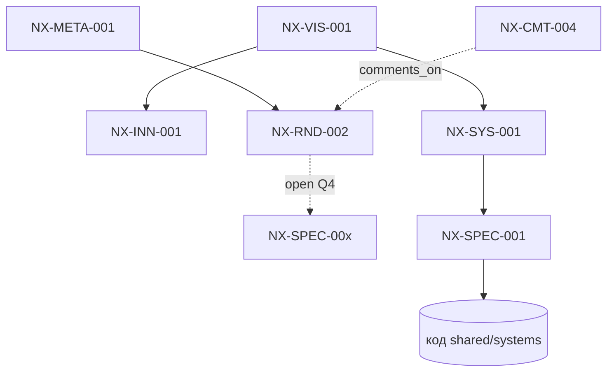

# Методология детализации «теория↔информация»

## TL;DR
Вики NEXUS должна расти как живое дерево: общий корень (видение) ветвится на всё более частные документы, и каждая ветка возникает не из хаоса, а из явного **подвопроса**. Документ описывает велосипед-с-крылышками: берём проверенные кирпичики (научный метод, декомпозиция «разделяй и властвуй», система контроля версий, трекер задач) и добавляем одно новое измерение — **применение этой машинерии к саморастущей гейм-вики, где узлы графа знаний связаны машиночитаемыми ссылками, а спор ведётся комментариями-на-комментарии с правилом «дозревания» документа до спеки и кода**.

## Краткое содержание
Проблема роя из десятков агентов, пишущих параллельно, — энтропия: дубли, сироты, противоречия, «желаемое за сделанное», документы, которые навсегда застряли в статусе «идея». [NX-META-001](../00-meta/CONSTITUTION.md) задаёт *что* писать (формат, слои, статусы); этот документ задаёт *как растить* — процесс, по которому один вопрос порождает один документ, документ дозревает по гейтам зрелости, а факты из практики возвращаются в теорию.

Методология состоит из четырёх машин:
1. **Машина декомпозиции** — дерево подвопросов с короткими id (Q1, Q1.1, Q1.1.2), где лист дерева, дозревший до самостоятельности, промоутится в документ `NX-*`.
2. **Машина таксономии** — два независимых измерения: `layer` (регистр: concept/technical/meta) и `abstraction` (высота: general/extended/detailed), плюс конвейер слоёв vision→innovation→system→spec→code.
3. **Машина зрелости** — гейты `idea→analyzed→prototyped→implemented` с явными чек-листами «дозрел».
4. **Машина обратной связи** — петля «теория→информация→теория»: прототип/телеметрия/ревью возвращаются в вики как новый документ или как supersede существующего.

Всё это держится на **прослеживаемости** через машиночитаемые поля шапки (`relates_to`, `depends_on`, `comments_on`, `superseded_by`), которые образуют граф, валидируемый скриптами (см. [NX-POLY-010](../50-polyglot/NX-POLY-010-innovation-on-proven.md)).

## Расширенное содержание (общее)

### Принцип: дерево, а не куча
Вики — это направленный граф документов, но *костяк* у него древовидный: от общего к частному. Корень — видение ([NX-VIS-001](../10-vision/NX-VIS-001-vision-and-pillars.md)). Каждый уровень вниз отвечает на вопрос «а конкретно как?» предыдущего. Горизонтальные рёбра (`relates_to`) — это лианы между ветками, они допустимы и поощряются, но не заменяют ствол.

Ключевая идея: **новая ветка не появляется произвольно — она появляется как ответ на зафиксированный подвопрос**. Подвопрос — это «обещание» будущего документа. Пока на него нет ответа, он живёт в поле `open_subquestions` родительского research-документа. Когда у агента есть, что сказать по подвопросу, и сказать это — больше абзаца, подвопрос **промоутится** в отдельный документ `NX-*`, а в родителе остаётся ссылка.

### Четыре машины методологии

**1. Декомпозиция (научный метод + «разделяй и властвуй»).**
Берём большой вопрос, режем на под-вопросы с короткими стабильными id. Правило хорошего разреза (как у научной гипотезы): подвопросы должны быть *по возможности независимы* (низкая связность между ветками) и *вместе покрывать* родителя (MECE — взаимоисключающи и совместно исчерпывающи, насколько это достижимо). Это прямой импорт из консалтинга/инженерии (issue trees) — проверенный кирпичик.

**2. Таксономия.**
Не путать «о чём документ» с «насколько он детальный». Два ортогональных измерения:
- `layer` — регистр мышления: `concept` (идея, зачем), `technical` (как устроено), `meta` (как мы работаем).
- `abstraction` — высота над землёй: `general` → `extended` → `detailed`.
Плюс **конвейер областей** (папки `10-vision … 40-specs … код`), по которому знание течёт вниз по мере дозревания.

**3. Зрелость (гейты).**
Поле `maturity` (`idea|analyzed|prototyped`) и `status` (`draft|proposed|accepted|superseded`) — это не украшение, а светофор. Переход через гейт требует выполнения чек-листа. Нельзя написать «Фаза 1 ✅», если код не доказывает обратное (прямой запрет из [NX-META-001](../00-meta/CONSTITUTION.md#sec2)).

**4. Обратная связь (теория↔информация).**
Самая важная и новая часть. Классическая вики растёт только «сверху» (люди пишут теорию). Наша — растёт и «снизу»: результат прототипа, цифра из телеметрии, баг из ревью — это **информация**, которая опровергает или уточняет **теорию**. Петля замыкается: информация порождает новый research-документ или supersede-ит старый. Так вики не протухает.

### Велосипед с крылышками
- **Колесо/автомобиль (не изобретаем заново):** научный метод (гипотеза→эксперимент→вывод), декомпозиция issue-tree, Git как источник истины и история, трекер задач со статусами, code review с тредами, traceability matrix из системной инженерии (требование↔тест↔код).
- **Крылышки (новое измерение):** вся эта машинерия применяется не к корпоративному проекту, а к **саморастущей дизайн-вики игры**, где (а) узел знания и узел задачи — это один и тот же markdown-файл с YAML-графом; (б) спор оформляется как **комментарий-на-комментарий** (документ `NX-CMT-*`, комментирующий другой `NX-CMT-*`), образуя тред научной полемики прямо в репозитории; (в) у документа есть формальный критерий «дозрел до кода», после которого его подхватывает второй рой кодеров.

## Детали и частные случаи

### Дерево подвопросов: правила нотации
- id подвопроса — `Q<путь>`: `Q3`, `Q3.1`, `Q3.1.2`. Путь стабилен: если `Q3.2` промоутнут в документ, id `Q3.2` **не переиспользуется** для нового вопроса (как и ID документов — неизменны).
- Глубина: практический предел — 3 уровня (`Qx.y.z`). Глубже — признак, что `Qx.y` пора делать документом со своим деревом.
- Каждый лист дерева имеет один из статусов: `open` (ждёт), `promoted→NX-XXX-###` (стал документом), `rejected: <причина>` (решили не делать), `folded→Qa.b` (слит с соседним).

### Жизненный цикл «подвопрос → документ» (конечный автомат)
```
open ──(есть содержательный ответ >1 абзаца)──▶ promoted(NX-XXX-###)
  │
  ├──(дубль/слишком мелкий)──▶ folded(Qa.b)
  └──(вне скоупа/неактуально)──▶ rejected(reason)

NX-XXX документ:  draft ──▶ proposed ──▶ accepted ──▶ (superseded_by NX-YYY)
maturity:         idea  ──▶ analyzed ──▶ prototyped ──▶ (implemented в коде)
```

### Критерии гейтов «дозрел»

| Гейт | Обязательные условия (чек-лист) |
|------|----------------------------------|
| `open → promoted` | ответ не помещается в абзац; ≥2 ссылки `relates_to`; есть хотя бы набросок реализации/вариантов |
| `idea → analyzed` | перечислены ≥2 альтернативы; названы риски; есть таблица выбора или критерии сравнения |
| `analyzed → prototyped` | есть псевдокод ИЛИ работающий прототип-ссылка; контракт API/событий описан; граничные случаи перечислены |
| `prototyped → implemented` | **contract-completeness**: сигнатуры, форматы данных, инварианты и тест-кейсы достаточны, чтобы кодер написал реализацию, не задавая вопросов |
| `draft → proposed` | шапка валидна; тело в порядке §5 конституции; DoD-чеклист пройден |
| `proposed → accepted` | нет неразрешённых блокирующих комментариев в тредах `NX-CMT-*` |

### Таксономия: матрица `layer × abstraction`
|              | general | extended | detailed |
|--------------|---------|----------|----------|
| **concept**  | видение, столпы (10-vision) | инновация целиком (20-innovation) | частный механик-кейс |
| **technical**| архитектура системы (30-systems) | подсистема | спека + псевдокод (40-specs) |
| **meta**     | конституция, эта методология | процессные регламенты | шаблоны, чек-листы |

### Цикл «теория↔информация»: что такое «информация»
1. **Результат прототипа** — «идея X на практике даёт Y FPS / Z строк / падает на краю карты».
2. **Телеметрия/измерение** — цифры из запущенной игры (баланс, удержание, нагрузка `nexus_api.php`).
3. **Ревью/спор** — вывод треда комментариев («согласились, что подход A проигрывает B по эффорту»).
Любой из трёх типов информации — повод создать research-документ `NX-RND-*` с разделом «что измерили» и обновить/supersede теоретический источник. Информация без зафиксированного следствия в вики — потеряна.

### Комментарии-на-комментарии: анти-свалка
Тред — это мини-дерево `NX-CMT-*`, где `comments_on` указывает на родителя (документ или другой комментарий). Чтобы тред не разрастался в болото:
- Комментарий обязан иметь **тип реплики**: `question | objection | refinement | support | decision`.
- Тред **закрывается** документом-`decision` (комментарий с `type: comment`, тегом `resolution`), который фиксирует вывод и при необходимости supersede-ит или уточняет целевой документ.
- Если тред родил самостоятельную идею — её **промоутят** в `NX-INN-*`/`NX-RND-*`, а в треде ставят `folded→NX-XXX`.

## Предложения и варианты реализации

### Вариант A (минимальный): дисциплина + ручной индекс
Только соглашения из этого документа + ручная сборка [INDEX.md](../00-meta/INDEX.md). Дёшево, но хрупко при росте роя. `effort: S`, `risk: med` (энтропия вернётся).

### Вариант B (рекомендуемый): дисциплина + валидаторы-линтеры
Соглашения + набор скриптов, валидирующих граф шапок (полиглот-пайплайн из [NX-POLY-010](../50-polyglot/NX-POLY-010-innovation-on-proven.md)). Скрипты гоняются в pre-commit и CI. `effort: M`, `risk: low`.

### Вариант C (амбициозный): живой граф знаний + дашборд здоровья
B + интерактивный граф (узлы-документы, рёбра-ссылки) и метрики здоровья вики в HTML-дашборде. `effort: L`. Откладываем до стабилизации B.

### Псевдокод: линтер графа вики (язык — Python, как генератор контента в монорепо)
```python
# tools/wiki_lint.py — валидатор графа знаний вики NEXUS (вариант B)
import sys, re, pathlib, yaml  # yaml: проверенный кирпичик для шапок

DESIGN = pathlib.Path("games/nexus/design")
FRONTMATTER = re.compile(r"^---\n(.*?)\n---\n", re.S)

def load_docs():
    docs = {}
    for path in DESIGN.rglob("NX-*.md"):
        text = path.read_text(encoding="utf-8")
        m = FRONTMATTER.match(text)
        if not m:
            yield_error(path, "нет YAML-шапки"); continue
        meta = yaml.safe_load(m.group(1))
        docs[meta["id"]] = {"meta": meta, "path": path}
    return docs

def lint(docs):
    ids = set(docs)
    problems = []
    for did, d in docs.items():
        meta = d["meta"]
        # 1) висячие ссылки (кроме псевдо-id NX-ARCH/NX-REVIEW и ещё-не-созданных)
        for field in ("relates_to", "depends_on", "comments_on", "superseded_by"):
            for ref in as_list(meta.get(field)):
                base = ref.split("#")[0]
                if base in ("NX-ARCH", "NX-REVIEW"):  # допустимые псевдо-id
                    continue
                if base not in ids:
                    problems.append((did, f"{field} -> неизвестный {ref} (сирота или ещё не написан)"))
        # 2) «желаемое за сделанное»: maturity=prototyped, но нет псевдокода/протолинка
        if meta.get("maturity") == "prototyped" and not has_pseudocode(d["path"]):
            problems.append((did, "maturity=prototyped без псевдокода/прототипа — запрещено §2 конституции"))
        # 3) сирота: ни на кого не ссылается и никто не ссылается (кроме корня)
        if not as_list(meta.get("relates_to")) and not referenced_by(did, docs):
            problems.append((did, "документ-сирота: <2 связей, нарушает DoD"))
        # 4) циклы в depends_on
    detect_cycles(docs, problems, edge="depends_on")
    return problems

def health_metrics(docs):
    return {
        "total": len(docs),
        "orphans": sum(1 for d in docs.values() if is_orphan(d, docs)),
        "stale_ideas": sum(1 for d in docs.values()         # идея, давно не дозревшая
                           if d["meta"].get("maturity") == "idea"),
        "spec_coverage": coverage(docs, layer="technical"), # доля систем, имеющих спеку
    }

if __name__ == "__main__":
    docs = dict(load_docs())
    problems = lint(docs)
    for did, msg in problems:
        print(f"[WARN] {did}: {msg}")
    print("HEALTH:", health_metrics(docs))
    sys.exit(1 if problems else 0)
```

### Псевдокод: промоушн подвопроса в документ (генератор-скаффолдер)
```python
# tools/promote_subquestion.py QID "slug" --area RND --layer meta
# Берёт open_subquestions родителя, создаёт NX-<AREA>-<next-id>-<slug>.md из TEMPLATE,
# проставляет relates_to родителя и помечает подвопрос как promoted в родительской шапке.
def promote(parent_id, qid, slug, area, layer):
    parent = load(parent_id)
    assert qid in open_questions(parent), f"{qid} не открыт у {parent_id}"
    new_id = next_free_id(area)                      # сканирует папку, берёт max+1
    scaffold = render_template(TEMPLATE, id=new_id, slug=slug, layer=layer,
                               relates_to=[parent_id], maturity="idea", status="draft")
    write(path_for(area, new_id, slug), scaffold)
    mark_subquestion(parent, qid, f"promoted→{new_id}")   # обновляем родителя
    return new_id
```

### Граф ссылок (Mermaid-набросок для дашборда варианта C)


## Что нового и какие кирпичики
> Раздел не обязателен для research-доков, но методология сама по себе — инновация процесса, поэтому фиксируем явно.

- **НОВОЕ:**
  1. Единый артефакт «узел знания = узел задачи» — markdown с YAML-графом служит и статьёй вики, и трекер-тикетом, и traceability-узлом одновременно.
  2. Формальный **конечный автомат «подвопрос→документ»** с короткими стабильными id `Qx.y`, превращающий исследовательскую повестку в исполняемый бэклог.
  3. **Гейты дозревания «теория→спека→код»** с contract-completeness как условием передачи второму рою кодеров.
  4. **Комментарии-на-комментарии с типами реплик и принудительным закрытием треда** — научная полемика, встроенная в репозиторий и валидируемая линтером.
  5. **Замкнутая петля «теория↔информация»** — практика обязана вернуться в вики как документ, иначе считается потерянной.
- **Источники (проверенные кирпичики):** научный метод (гипотеза→эксперимент→вывод); декомпозиция «разделяй и властвуй» и issue-trees / MECE из инженерии и консалтинга (`c20-proven`, `humanities`); системная инженерия — traceability matrix (требование↔тест↔реализация); Git как источник истины; code review с тредами; конечные автоматы для статусов.
- **Чего нет в других играх (или редко):** дизайн-документация большинства игр — это либо один монолитный GDD, либо разрозненный Confluence без формального графа и без петли обратной связи от телеметрии к теории. Машиночитаемый, само-валидируемый граф знаний с гейтами дозревания до кода — редкость в геймдеве.

## Риски, открытые вопросы
- **Бюрократизация.** Слишком жёсткий процесс убивает скорость роя. Митигация: вариант B (линтеры предупреждают, а не блокируют всё подряд), гейты — чек-листы, а не суды.
- **Коллизии ID в параллельном рое** (Q2.2). `next_free_id` по сканированию папки гонщит при одновременной записи. Митигация: резервирование диапазонов id на агента, либо постпроцесс-перенумерация сборщиком.
- **Протухание петли обратной связи.** Пока нет запущенной игры с телеметрией, «информация» — только прототипы и ревью. Полная петля (Q5) дозреет позже.
- **Ссылки на ещё не созданные документы** (NX-SPEC-00x, NX-POLY-010) — допустимо по §6 конституции, но линтер должен отличать «ещё не написан» от «опечатка/сирота».
- **Глубина дерева подвопросов** (Q1.3) — где граница между полезной детализацией и шумом, эмпирически не проверена.
- Полное дерево подвопросов вынесено в поле `open_subquestions` шапки (Q1–Q7) для будущей детализации отдельными документами.

## Комментарии
Это методологический документ; он сам комментирует §5 и §6 [NX-META-001](../00-meta/CONSTITUTION.md) — уточняет *как* применять заданный там формат на практике (процесс роста, а не только структура файла). Развёрнутая полемика по гейтам зрелости — кандидат на отдельный тред `NX-CMT-*`.

## Связанные документы
- [NX-META-001 Конституция дизайн-вики](../00-meta/CONSTITUTION.md) — правила и формат (этот документ — про процесс поверх них)
- [NX-META-002 Шаблон документа](../00-meta/TEMPLATE.md)
- [NX-META-003 Мастер-индекс](../00-meta/INDEX.md)
- [NX-POLY-010 Полиглот-пайплайн инструментов](../50-polyglot/NX-POLY-010-innovation-on-proven.md) — линтеры/валидаторы графа (реализация варианта B)
- [NX-VIS-001 Видение и столпы](../10-vision/NX-VIS-001-vision-and-pillars.md) — корень дерева
- [NX-STRAT-001 Стратегия и триаж результатов](../15-strategy/NX-STRAT-001-strategy-and-forks.md) — куда втекает «информация» из петли
